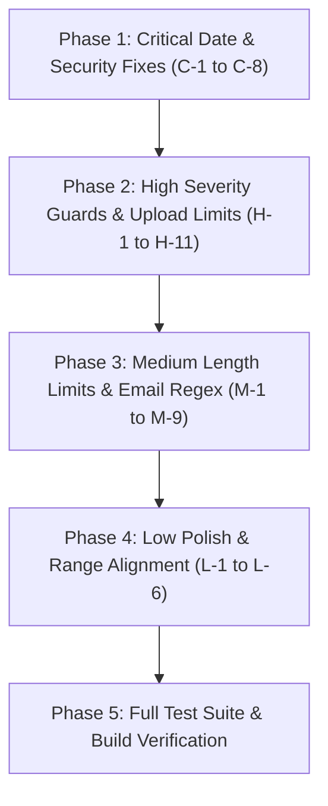

# Comprehensive Validation Audit & Remediation Plan

This document provides an exhaustive, field-by-field audit of all input validation vulnerabilities across the **eFlow** codebase, along with exact file locations, line numbers, existing code snippets, precise fixes, and a step-by-step implementation plan.

---

## Table of Contents
1. [Executive Summary & Severity Distribution](#executive-summary--severity-distribution)
2. [Compliance & Architectural Constraints (AGENTS.md)](#compliance--architectural-constraints-agentsmd)
3. [Exhaustive Issue Catalog (All 34 Gaps)](#exhaustive-issue-catalog-all-34-gaps)
   - [Critical Severity (C-1 to C-8)](#critical-severity-c-1-to-c-8)
   - [High Severity (H-1 to H-11)](#high-severity-h-1-to-h-11)
   - [Medium Severity (M-1 to M-9)](#medium-severity-m-1-to-m-9)
   - [Low Severity (L-1 to L-6)](#low-severity-l-1-to-l-6)
4. [Step-by-Step Phased Implementation Plan](#step-by-step-phased-implementation-plan)
5. [Verification & Regression Testing Strategy](#verification--regression-testing-strategy)

---

## Executive Summary & Severity Distribution

| Severity | Count | Primary Risk Themes |
|---|:---:|---|
| **🔴 Critical** | **8** | Unbounded project/activity dates, past-date acceptance, cross-field inversion (target < start), future meeting & receipt recording, password policy fragmentation |
| **🟠 High** | **11** | Unrestricted file uploads (no size/type limits), bypassable passphrase length, inverted date filters, missing text length limits |
| **🟡 Medium** | **9** | Missing textarea `maxLength` attributes, zero-amount budget entries, unvalidated email strings |
| **🔵 Low** | **6** | Premature login length gating, unrealistic numeric bounds (100,000h), zero-budget cap semantics |
| **Total** | **34** | **100% of discovered validation gaps** |

---

## Compliance & Architectural Constraints (AGENTS.md)

1. **Behavior Preservation**: No changes to database schemas, RLS policies, Supabase stored procedures, backend Python APIs, or public service return types.
2. **Client-Side Enforcement**: All fixes consist of semantic HTML attribute enforcement (`min`, `max`, `minLength`, `maxLength`, `accept`, `required`) coupled with pre-submit validation guards and user-friendly toast/inline error notifications.
3. **Philippine Standard Time Synchronization**: Date constraints utilize `getPhilippineCalendarDate()` (or `Asia/Manila` / `Asia/Singapore` UTC+8) to eliminate timezone date discrepancies.

---

## Exhaustive Issue Catalog (All 34 Gaps)

```
================================================================================
CRITICAL SEVERITY (C-1 to C-8)
================================================================================
```

### [C-1] Project Dates Missing Past-Date Guard & Cross-Field Validation

- **Files**:
  - `src/app/features/projects/components/project-command/ProjectPlanTab.tsx` (Lines 259–278, 280–286)
  - `src/app/features/projects/components/project-command/ProjectPlanInspector.tsx` (Lines 435–454, 456–465)
- **Vulnerability**:
  In `ProjectPlanTab` and `ProjectPlanInspector`, project `startDate` and `targetDate` are raw `type="date"` inputs with no `min` attributes and no cross-field validation. Users can set target dates prior to start dates, and set start dates decades in the past. (Only `ProjectSettingsDialog.tsx` previously had this validation.)
- **Existing Code (`ProjectPlanTab.tsx` L259–278)**:
  ```tsx
  <div className="grid grid-cols-2 gap-2">
    <Field label="Start date">
      <input
        type="date"
        value={form.startDate}
        onChange={(event) =>
          setForm({ ...form, startDate: event.target.value })
        }
        className="eflow-control"
      />
    </Field>
    <Field label="Target date">
      <input
        type="date"
        value={form.targetDate}
        onChange={(event) =>
          setForm({ ...form, targetDate: event.target.value })
        }
        className="eflow-control"
      />
    </Field>
  </div>
  ```
- **Remediation**:
  1. Add `min={getPhilippineCalendarDate()}` to start date (or allow past start only if already saved).
  2. Add `min={form.startDate || getPhilippineCalendarDate()}` to target date.
  3. In `saveProject()`, validate:
     ```ts
     if (form.startDate && form.targetDate && form.targetDate < form.startDate) {
       toast("Target date cannot precede start date.", "error");
       return;
     }
     ```

---

### [C-2] Milestone / Activity Due Dates Allow Past Dates & Exceed Project Target Date

- **Files**:
  - `src/app/features/projects/components/project-command/ProjectPlanTab.tsx` (Lines 306–311, 410–416)
  - `src/app/features/projects/components/project-command/ProjectPlanInspector.tsx` (Lines 202–207, 604–610)
- **Vulnerability**:
  New activity creation (`newDue`) and inline milestone editing (`dueDate`) do not enforce `min` or `max`. Users can schedule project milestones in the past or beyond the project's target completion date.
- **Existing Code (`ProjectPlanTab.tsx` L306–311)**:
  ```tsx
  <input
    type="date"
    value={newDue}
    onChange={(event) => setNewDue(event.target.value)}
    className="eflow-control"
  />
  ```
- **Remediation**:
  1. Add `min={getPhilippineCalendarDate()}`.
  2. Add `max={project.targetDate || undefined}`.
  3. In `addMilestone()`, verify `if (newDue && newDue < getPhilippineCalendarDate()) { toast("Activity due date cannot be in the past.", "error"); return; }`.

---

### [C-3] `DraftCockpit.tsx` Proposal Activity Schedule Date Unbounded

- **File**: `src/app/features/proposal-import/components/DraftCockpit.tsx` (Lines 384–398)
- **Vulnerability**:
  Proposal activity schedules during draft import have no bounds. Activities can be assigned arbitrary historical or invalid future dates.
- **Existing Code (L384–398)**:
  ```tsx
  <input
    aria-label={`${activity.title || `Activity ${activity.ai + 1}`} target date`}
    type="date"
    value={activity.schedule}
    onChange={(event) =>
      onUpdateActivity(
        program.pi,
        project.pj,
        activity.ai,
        activity.title,
        event.target.value,
      )
    }
    className="h-9 w-[148px] rounded-lg border border-input bg-input-background px-3 text-[11px] text-foreground outline-none transition-all focus:border-ring focus:ring-2 focus:ring-ring/15"
  />
  ```
- **Remediation**:
  Add `min={getPhilippineCalendarDate()}` to ensure imported draft activities cannot be scheduled in the past.

---

### [C-4] `ImportTaskReview.tsx` Tasks & Subitems Missing Date Bounds & Hierarchy Constraints

- **File**: `src/app/features/project-import/components/ImportTaskReview.tsx` (Lines 16, 23)
- **Vulnerability**:
  During project plan imports, tasks and subitems can be set with `dueDate < startDate` or dates in the past. Subitem dates are not constrained by parent task due dates.
- **Existing Code (L16, L23)**:
  ```tsx
  <td className="pi-dates">
    <label>Start<input type="date" value={task.startDate} disabled={disabled} onChange={e => onChange(task.key, { startDate: e.target.value })}/></label>
    <label>Due<input type="date" value={task.dueDate} disabled={disabled} onChange={e => onChange(task.key, { dueDate: e.target.value })}/></label>
  </td>
  ...
  <input type="date" aria-label={`Subitem due ${task.key} ${index+1}`} value={subitem.dueDate} disabled={disabled} onChange={e => onChange(task.key, { subitems: task.subitems.map((s, i) => i === index ? { ...s, dueDate: e.target.value } : s) })}/>
  ```
- **Remediation**:
  1. Add `min={getPhilippineCalendarDate()}` to `task.startDate`.
  2. Add `min={task.startDate || getPhilippineCalendarDate()}` to `task.dueDate`.
  3. Add `min={task.startDate || getPhilippineCalendarDate()}` and `max={task.dueDate || undefined}` to `subitem.dueDate`.

---

### [C-5] Password Policy Fragmentation (6 vs 8 vs 12 Characters) & Missing `maxLength`

- **Files**:
  - `src/app/features/authentication/services/loginValidation.ts` (Line 6)
  - `src/app/features/administration/components/user-management/CreateUserModal.tsx` (Lines 188–189, 387)
  - `src/app/features/settings/components/SecuritySettingsPage.tsx` (Lines 34, 75, 80, 84)
  - `src/app/features/invitations/components/AcceptInvitationPage.tsx` (Lines 63–64)
- **Vulnerability**:
  - `AcceptInvitationPage` correctly requires 12 characters.
  - `CreateUserModal` only requires 6 characters.
  - `SecuritySettingsPage` requires 8 characters.
  - `loginValidation.ts` erroneously rejects passwords < 6 characters during login.
  - No password fields define `maxLength={128}`, exposing components to buffer/DoS abuse.
- **Existing Code (`CreateUserModal.tsx` L188–189)**:
  ```ts
  if (!form.password || form.password.length < 6)
    errs.password = "Min 6 characters";
  ```
- **Remediation**:
  1. Standardize password creation/change rule across `CreateUserModal.tsx` and `SecuritySettingsPage.tsx` to 12 characters minimum (`minLength={12}`, `maxLength={128}`).
  2. Remove length restriction from `loginValidation.ts` (login should only verify that password is not empty).

---

### [C-6] `GovernanceRecordPanel.tsx` Meeting Date Allows Future Dates & Missing Required Check

- **File**: `src/app/features/interdepartment-collaboration/components/governance/GovernanceRecordPanel.tsx` (Lines 205–211, 231–246)
- **Vulnerability**:
  Formal meeting dates can be recorded in the future, violating legal audit trail integrity. The save button does not check if resolution or meeting date are blank.
- **Existing Code (L205–211, L231–245)**:
  ```tsx
  <input
    aria-label="Meeting date"
    type="date"
    value={meetingDate}
    onChange={(event) => setMeetingDate(event.target.value)}
    className="..."
  />
  ...
  <button
    type="button"
    disabled={busy}
    onClick={() => void onSaveRecord({...})}
    ...
  >
  ```
- **Remediation**:
  1. Add `max={getPhilippineCalendarDate()}` to meeting date input.
  2. Disable submit button when `!resolution.trim() || !meetingDate`:
     `disabled={busy || !resolution.trim() || !meetingDate}`.

---

### [C-7] `CashLiquidationDialog.tsx` Receipt Date Allows Future Dates & Historical Drift

- **File**: `src/app/features/budget/components/CashLiquidationDialog.tsx` (Lines 63–67, 108, 160–162)
- **Vulnerability**:
  Receipt date input has no `max` constraint. Users can file receipts with future dates, creating fraudulent accounting records.
- **Existing Code (L108, L160–162)**:
  ```tsx
  <Field label="Receipt date" type="date" value={receipt.receiptDate} onChange={(value) => update(receipt.id, { receiptDate: value })} />
  ...
  function Field({ label, value, onChange, type = "text", inputClassName = "" }: ...) {
    return <label><span ...>{label}</span><Input type={type} min={type === "number" ? 0 : undefined} step={type === "number" ? "0.01" : undefined} value={value} onChange={(event) => onChange(event.target.value)} ... /></label>;
  }
  ```
- **Remediation**:
  1. Add `max?: string` to `Field` props and forward to `<Input />`.
  2. Pass `max={getPhilippineCalendarDate()}` to `Receipt date`.
  3. In `invalid` boolean guard (L63–67), add:
     `receipts.some(r => r.receiptDate > getPhilippineCalendarDate())`.

---

### [C-8] Subitem and Subtask Due Dates Missing Past Date `min` Guard

- **Files**:
  - `src/app/features/project-table/components/SubitemRows.tsx` (Lines 66–67)
  - `src/app/features/subtasks/components/TaskSubtasksWidget.tsx` (Lines 455–459)
- **Vulnerability**:
  Both components define `max={parentDue}` but have no `min`, allowing creation of subitems/subtasks that are already overdue at birth.
- **Existing Code (`SubitemRows.tsx` L66–67)**:
  ```tsx
  extraFields={saving => <input type="date" aria-label={'Due date for new subitem to ' + task.title}
    value={dueDate} max={parentDue} readOnly={saving} onChange={event => setDueDate(event.target.value)} />}
  ```
- **Remediation**:
  Add `min={getPhilippineCalendarDate()}` to both subitem and subtask date inputs.

---

```
================================================================================
HIGH SEVERITY (H-1 to H-11)
================================================================================
```

### [H-1] `RecurringTemplateForm.tsx` Scheduled Run Allows Past Date/Time

- **File**: `src/app/features/tasks/components/RecurringTemplateForm.tsx` (Lines 182–188)
- **Vulnerability**:
  `type="datetime-local"` has no `min`, permitting recurring schedules initialized in the past.
- **Existing Code (L182–188)**:
  ```tsx
  <input
    aria-label="First scheduled run"
    type="datetime-local"
    value={nextRun}
    onChange={(event) => setNextRun(event.target.value)}
    className={inputClass}
  />
  ```
- **Remediation**:
  Add `min={new Date().toISOString().slice(0, 16)}`. Validate on submit that `new Date(nextRun).getTime() > Date.now()`.

---

### [H-2] `ProjectAccessPanel.tsx` Access End Date Has No `min`

- **File**: `src/app/features/project-access/components/ProjectAccessPanel.tsx` (Line 21)
- **Vulnerability**:
  External viewer/member project access end date can be set to yesterday or earlier, generating instantly expired access tokens.
- **Existing Code (Line 21)**:
  ```tsx
  <label>Access ends after this date · {data.timezone||'Asia/Singapore'}<input type="date" value={end} disabled={busy||!!request.current} onChange={e=>setEnd(e.target.value)}/></label>
  ```
- **Remediation**:
  Add `min={getPhilippineCalendarDate()}`.

---

### [H-3] `WorkTreeEditor.tsx` Progress Input Capped at 99% with No Contextual Explanation

- **File**: `src/app/features/nested-work/components/WorkTreeEditor.tsx` (Lines 54–55)
- **Vulnerability**:
  Contributed progress is strictly clamped to `max={99}`, but without visible instruction explaining that 100% requires reviewer sign-off, leading users to believe the UI is broken.
- **Existing Code (Lines 54–55)**:
  ```tsx
  {edit.command==='progress'&&<label>Progress<input type="number" min={0} max={99} value={progress} disabled={locked} onChange={e=>update('progress',Number(e.target.value))}/></label>}
  {edit.command==='review'&&<label>Decision<select value={progress===100?'approve':'reject'} disabled={locked} onChange={e=>update('progress',e.target.value==='approve'?100:99)}><option value="approve">Approve personal work</option><option value="reject">Return for changes</option></select></label>}
  ```
- **Remediation**:
  Add informative subtext:
  `<span className="text-[10px] text-muted-foreground">Progress is capped at 99% until formal review approval.</span>`

---

### [H-4] `JournalAdjustmentDialog.tsx` Entry Date Missing Future Guard & Header Inputs Missing Length Caps

- **File**: `src/app/features/budget/components/JournalAdjustmentDialog.tsx` (Lines 300–316, 433–466)
- **Vulnerability**:
  `Entry date` allows future accounting dates. `Reference number` and `Memo` text fields lack length limits.
- **Existing Code (Lines 300–316)**:
  ```tsx
  <Field label="Entry date" type="date" value={entryDate} onChange={setEntryDate} />
  <Field label="Reference number" value={reference} onChange={setReference} />
  <Field label="Memo / correction reason" value={memo} onChange={setMemo} />
  ```
- **Remediation**:
  1. Add `max?: string` and `maxLength?: number` to `Field` component.
  2. Pass `max={getPhilippineCalendarDate()}` to `Entry date`.
  3. Pass `maxLength={64}` to `Reference number` and `maxLength={500}` to `Memo`.

---

### [H-5] `ProgressUpdateForm.tsx` No File Size or MIME Type Whitelist

- **File**: `src/app/components/workflow/ProgressUpdateForm.tsx` (Lines 171–176)
- **Vulnerability**:
  Task progress updates allow arbitrary file attachments of any size or type (including `.exe` or multi-gigabyte files).
- **Existing Code (Lines 171–176)**:
  ```tsx
  <input
    type="file"
    className="hidden"
    onChange={(e) => setFile(e.target.files?.[0] || null)}
  />
  ```
- **Remediation**:
  1. Add `accept="image/jpeg,image/png,image/webp,application/pdf,.docx,.xlsx,.doc,.xls"`.
  2. Validate `file.size <= 25 * 1024 * 1024` (25 MB limit); toast error if exceeded.

---

### [H-6] `SubmitForReviewForm.tsx` No Evidence File Size, Type, or Count Limit

- **File**: `src/app/components/workflow/SubmitForReviewForm.tsx` (Lines 148–156)
- **Vulnerability**:
  Review submissions allow unlimited file uploads with zero type filtering or file count limits.
- **Existing Code (Lines 148–156)**:
  ```tsx
  <input
    type="file"
    multiple
    className="hidden"
    onChange={(event) =>
      setFiles(Array.from(event.target.files || []))
    }
  />
  ```
- **Remediation**:
  1. Add `accept="image/jpeg,image/png,image/webp,application/pdf,.docx,.xlsx"`.
  2. Validate each file size <= 25 MB and total files <= 10.

---

### [H-7] `SubtaskTemplateEditor.tsx` Missing MaxLength on Template Name & Item Titles

- **File**: `src/app/features/work-templates/components/SubtaskTemplateEditor.tsx` (Lines 106–116, 182–196)
- **Vulnerability**:
  Checklist template names and individual checklist item titles have no character length limits.
- **Existing Code (Lines 106–116, 182–196)**:
  ```tsx
  <input
    value={draft.title}
    onChange={(event) => setDraft((current) => ({ ...current, title: event.target.value }))}
    placeholder="e.g. Meeting Preparation"
    className="..."
  />
  ...
  <input
    value={item.title}
    onChange={(event) => ... }
    placeholder="Describe the subtask…"
    className="..."
  />
  ```
- **Remediation**:
  Add `maxLength={120}` to template title and `maxLength={250}` to each checklist item title.

---

### [H-8] `HeadReportsWorkspace.tsx` Custom Date Range Filter Allows `from > to`

- **File**: `src/app/features/reports/components/HeadReportsWorkspace.tsx` (Lines 401–416)
- **Vulnerability**:
  Custom date filters do not couple `from` and `to`, allowing inverted queries that silently produce empty analytics reports.
- **Existing Code (Lines 401–416)**:
  ```tsx
  <input
    type="date"
    value={fromDate}
    onChange={(event) => setFromDate(event.target.value)}
    className="..."
  />
  ...
  <input
    type="date"
    value={toDate}
    onChange={(event) => setToDate(event.target.value)}
    className="..."
  />
  ```
- **Remediation**:
  1. Add `max={toDate || getPhilippineCalendarDate()}` to `fromDate`.
  2. Add `min={fromDate}` and `max={getPhilippineCalendarDate()}` to `toDate`.

---

### [H-9] `BackupExportWorkspace.tsx` Passphrase Missing HTML `minLength` & Immediate Visual Feedback

- **File**: `src/app/features/administration/components/data-tools/BackupExportWorkspace.tsx` (Lines 536–557)
- **Vulnerability**:
  Passphrase requirement is only enforced via JS `canStart` state. Inputs lack HTML `minLength={12}`, giving no browser-level validation feedback.
- **Existing Code (Lines 536–557)**:
  ```tsx
  <input
    type="password"
    value={passphrase}
    onChange={(event) => setPassphrase(event.target.value)}
    placeholder="At least 12 characters"
    className="..."
  />
  ```
- **Remediation**:
  Add `minLength={12}` and `maxLength={128}` to both passphrase inputs, and display inline character requirement counter.

---

### [H-10] `ProfileSettingsPage.tsx` Avatar Upload Missing Frontend Size Check

- **File**: `src/app/features/settings/components/ProfileSettingsPage.tsx` (Lines 84–103, 190)
- **Vulnerability**:
  Avatar file input specifies "Up to 2 MB" in UI text, but the upload handler performs zero client-side size checking before initiating upload.
- **Existing Code (Lines 84–91)**:
  ```ts
  const onChoosePhoto = async (event: ChangeEvent<HTMLInputElement>) => {
    const file = event.target.files?.[0];
    event.target.value = '';
    if (!file || !userProfile) return;
    setAvatarSaving(true);
  ```
- **Remediation**:
  Add upfront size guard:
  ```ts
  if (file.size > 2 * 1024 * 1024) {
    setAvatarResult({ tone: 'error', text: 'Profile photo must be 2 MB or smaller.' });
    return;
  }
  ```

---

### [H-11] `GovernanceRecordPanel.tsx` Signed Minutes Upload Missing Size Guard

- **File**: `src/app/features/interdepartment-collaboration/components/governance/GovernanceRecordPanel.tsx` (Lines 224–230)
- **Vulnerability**:
  Minutes file attachment accepts `.pdf,image/*,.doc,.docx` with no file size ceiling.
- **Existing Code (Lines 224–230)**:
  ```tsx
  <input
    type="file"
    accept=".pdf,image/*,.doc,.docx"
    className="hidden"
    onChange={(event) => setFile(event.target.files?.[0])}
  />
  ```
- **Remediation**:
  Check `event.target.files?.[0].size <= 25 * 1024 * 1024` before updating state.

---

```
================================================================================
MEDIUM SEVERITY (M-1 to M-9)
================================================================================
```

### [M-1] `CreateUserModal.tsx` Email Relies Solely on Browser Form Check Without Regex

- **File**: `src/app/features/administration/components/user-management/CreateUserModal.tsx` (Lines 187, 378)
- **Vulnerability**: Only checks `!form.email.trim()`. Bypasses domain checks or malformed formats.
- **Remediation**: Add regex validation: `/^[^\s@]+@[^\s@]+\.[^\s@]+$/.test(form.email.trim())` and `maxLength={254}`.

### [M-2] `SubtaskTemplateApplyDialog.tsx` Missing Item Title MaxLength

- **File**: `src/app/features/work-templates/components/SubtaskTemplateApplyDialog.tsx` (Line 156)
- **Vulnerability**: Editable preview titles have no `maxLength`.
- **Remediation**: Add `maxLength={250}`.

### [M-3] `ProposalBudgetSection.tsx` Amount Min={0} Allows Zero Value Particulars

- **File**: `src/app/features/budget/components/ProposalBudgetSection.tsx` (Lines 64, 73, 74)
- **Vulnerability**: Budget line items can have ₱0.00 amount or infinite magnitude. Category and particular names have no `maxLength`.
- **Remediation**: Add `min={0.01}`, `max={9999999999}`. Add `maxLength={120}` on category and `maxLength={200}` on particular.

### [M-4] `ActivityFilterControls.tsx` Date Range Filters Allow Inverted Interval

- **File**: `src/app/features/projects/activity/ActivityFilterControls.tsx` (Lines 45–59)
- **Vulnerability**: `from` and `to` are independent, allowing `from > to`.
- **Remediation**: Add `max={filters.to || undefined}` to `from`, and `min={filters.from || undefined}` to `to`.

### [M-5] `SecuritySettingsPage.tsx` Password Inputs Missing MaxLength

- **File**: `src/app/features/settings/components/SecuritySettingsPage.tsx` (Lines 75, 80, 84)
- **Vulnerability**: `current-password`, `new-password`, and `confirm-password` have no `maxLength`.
- **Remediation**: Add `maxLength={128}` to all 3 inputs.

### [M-6] `ProgressUpdateForm.tsx` Next Step & Note Textareas Missing MaxLength

- **File**: `src/app/components/workflow/ProgressUpdateForm.tsx` (Lines 125–130, 150–156)
- **Vulnerability**: `nextStep` and `note` have no character ceilings.
- **Remediation**: Add `maxLength={300}` on `nextStep` and `maxLength={3000}` on `note`.

### [M-7] `SubmitForReviewForm.tsx` Completion Note Missing MaxLength

- **File**: `src/app/components/workflow/SubmitForReviewForm.tsx` (Lines 109–117)
- **Vulnerability**: Review note has no `maxLength`.
- **Remediation**: Add `maxLength={5000}`.

### [M-8] `SubtaskTemplateEditor.tsx` Description Textarea Missing MaxLength

- **File**: `src/app/features/work-templates/components/SubtaskTemplateEditor.tsx` (Lines 120–131)
- **Vulnerability**: Template description textarea has no `maxLength`.
- **Remediation**: Add `maxLength={1000}`.

### [M-9] `GovernanceRecordPanel.tsx` Resolution Number & Endorsement Missing MaxLength

- **File**: `src/app/features/interdepartment-collaboration/components/governance/GovernanceRecordPanel.tsx` (Lines 198–220)
- **Vulnerability**: Resolution number and endorsement textarea lack length boundaries.
- **Remediation**: Add `maxLength={100}` on resolution number and `maxLength={2000}` on endorsement.

---

```
================================================================================
LOW SEVERITY (L-1 to L-6)
================================================================================
```

### [L-1] `loginValidation.ts` Premature Password Length Check on Login

- **File**: `src/app/features/authentication/services/loginValidation.ts` (Line 6)
- **Vulnerability**: Enforces `password.length < 6` on login, conflicting with 12-char account creation policy and giving confusing errors during authentication.
- **Remediation**: Remove `else if (password.length < 6)` check on login; verify only non-empty.

### [L-2] `HeadReportsWorkspace.tsx` Custom Date Range Filter Allows Future Dates

- **File**: `src/app/features/reports/components/HeadReportsWorkspace.tsx` (Line 412)
- **Vulnerability**: Report `toDate` can be set to future dates.
- **Remediation**: Add `max={getPhilippineCalendarDate()}`.

### [L-3] `DraftCockpit.tsx` Activity Title Missing MaxLength

- **File**: `src/app/features/proposal-import/components/DraftCockpit.tsx` (Lines 360–377)
- **Vulnerability**: Activity title has no `maxLength`.
- **Remediation**: Add `maxLength={250}`.

### [L-4] `WorkBudgetCard.tsx` Cap Amount Input Min={0} Allows Zero Value

- **File**: `src/app/features/budget/components/WorkBudgetCard.tsx` (Lines 492–495)
- **Vulnerability**: Input has `min={0}`, while submit button is disabled when `capAmount <= 0`.
- **Remediation**: Align input with `min={0.01}`.

### [L-5] `ImportTaskReview.tsx` Estimated Hours Allows Unrealistic 100,000 Hours

- **File**: `src/app/features/project-import/components/ImportTaskReview.tsx` (Line 17)
- **Vulnerability**: `max={100000}` permits over 11 years for a single task.
- **Remediation**: Reduce to `max={10000}`.

### [L-6] `CashLiquidationDialog.tsx` Refund Cash Return Date Has No Max Bound

- **File**: `src/app/features/budget/components/CashLiquidationDialog.tsx` (Line 135)
- **Vulnerability**: Cash return refund date can be scheduled in the future.
- **Remediation**: Add `max={getPhilippineCalendarDate()}`.

---

## Step-by-Step Phased Implementation Plan



### Phase 1: Critical Security & Integrity Fixes (C-1 to C-8)
1. **Date Bounds in Projects**: Update `ProjectPlanTab.tsx` and `ProjectPlanInspector.tsx` with `min` attributes and cross-field target >= start checks.
2. **Activity & Subtask Dates**: Add `min={getPhilippineCalendarDate()}` and `max={parentDue}` in `SubitemRows.tsx`, `TaskSubtasksWidget.tsx`, `DraftCockpit.tsx`, and `ImportTaskReview.tsx`.
3. **Password Policy Unification**: Standardize 12-char minimum in `CreateUserModal.tsx` and `SecuritySettingsPage.tsx`; add `maxLength={128}`. Remove premature length gating in `loginValidation.ts`.
4. **Audit Trail Date Integrity**: Constrain meeting dates in `GovernanceRecordPanel.tsx` and receipt dates in `CashLiquidationDialog.tsx` to `max={today}`.

### Phase 2: High Severity Guardrails & File Security (H-1 to H-11)
1. **File Upload Limits**: Add `accept` and 25 MB size validation in `ProgressUpdateForm.tsx`, `SubmitForReviewForm.tsx`, and `GovernanceRecordPanel.tsx`. Add 2 MB limit check in `ProfileSettingsPage.tsx`.
2. **Date Interval Enforcements**: Couple from/to date inputs in `HeadReportsWorkspace.tsx` and `ActivityFilterControls.tsx`. Add `min` to `RecurringTemplateForm.tsx` and `ProjectAccessPanel.tsx`.
3. **Backup & Tree UX**: Add `minLength={12}` in `BackupExportWorkspace.tsx` and clarify the 99% review rule in `WorkTreeEditor.tsx`.

### Phase 3: Text Boundaries & Field Hygiene (M-1 to M-9)
1. **Email Regex Check**: Add email format verification in `CreateUserModal.tsx`.
2. **Textarea & Input MaxLengths**: Add appropriate `maxLength` boundaries to all textareas in `ProgressUpdateForm.tsx`, `SubmitForReviewForm.tsx`, `SubtaskTemplateEditor.tsx`, and `GovernanceRecordPanel.tsx`.
3. **Budget Particular Constraints**: Add `min={0.01}` and `maxLength` in `ProposalBudgetSection.tsx`.

### Phase 4: Polish & Minor Range Alignment (L-1 to L-6)
1. Clean up `WorkBudgetCard.tsx` min cap, `ImportTaskReview.tsx` hour limits, and report max dates.

---

## Verification & Regression Testing Strategy

Following `AGENTS.md` rules:
1. **Type & Lint Check**: Run `npm run check` after each phase.
2. **Unit Test Suite**: Run `npm test` to verify no existing tests break.
3. **Production Build**: Run `npm run build` to guarantee bundle compilation without errors.
4. **Graphify Sync**: Run `npm run graph:update` once structural refactors complete.
