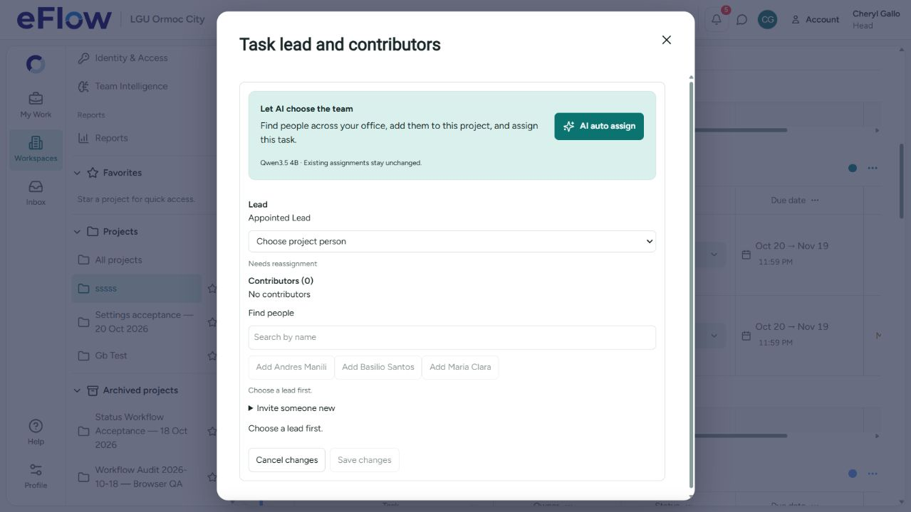
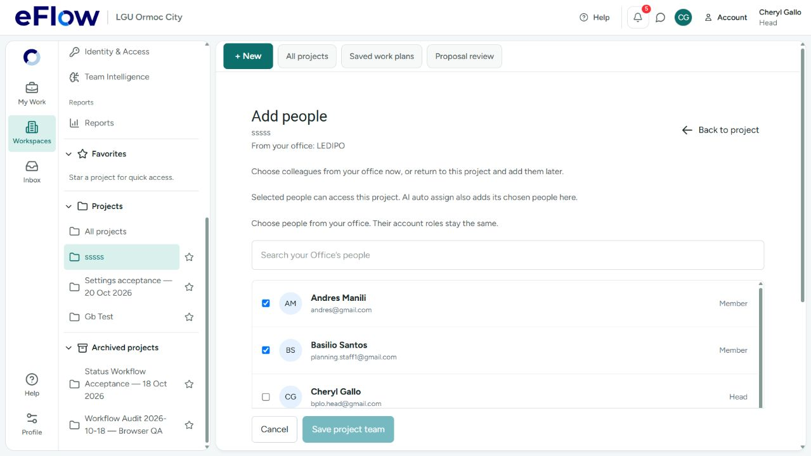

# AI task assignment and optional project groups

Implemented against hosted target `ixnfphgjyelhckjwjkdv`. Deployed migration:
`20261019232627_optional_groups_and_ai_task_staffing.sql`. Generated in the isolated
workspace populated from hosted migration history; the repository filename matches
the actual deployed timestamp. No historical migration was rewritten.

## User-visible behavior

- An authorized Head can delete any empty group, including the initial/default
  group and the final remaining group. Groups containing current or archived tasks
  remain protected. Deleted task history is retained independently of the group.
- A successful project PDF import removes a genuinely empty default group in the
  same transaction. A default containing tasks is preserved. Receipt retries do
  not repeat cleanup or recreate imported work.
- The task lead/contributors dialog has **AI auto assign** for an unassigned,
  unstarted Office task. It uses **Qwen3.5 4B**, selects a lead and necessary
  contributors, enrolls new Office candidates into this project and saves staffing
  atomically through the canonical task command. Existing assignments and subtask
  leads are preserved; they use the existing reviewed manual appointment flow.
- Candidate context comes from the authorized available Office directory and
  already accepted eligible project guests, rather than the current selected team.
  Expired/ended access is excluded. New enrollments do not change account roles,
  permanent Office membership, or issue invitations to unrelated accounts.
- Only confirmed professional facts and current Office workload are supplied.
  People without confirmed professional details remain available with an explicit
  unknown-skills/workload summary, without invented qualifications.
- **Add people** reflects committed membership changes as checked selections.
  Quiet refresh preserves an unsaved manual draft. **Reload selection** is removed;
  **Back to project** includes the Vibe left-arrow icon.

The broader, older staffing recommendation in `project-index-redesign-2026-10-20.md`
is superseded where it restricted AI selection to already-selected project members.
There is no new mandatory external Office selection or permanent invited-Office
registration flow in this change.

## Verification

- 73 distinct focused client regressions passed across creation/group deletion, PDF draft,
  membership drafts, canonical staffing, authority, staffing safety and the new
  auto-assignment service.
- Seven application-gateway staffing tests passed, including canonical context
  replacement and server-enforced Qwen routing.
- All 120 offline AI-server tests passed, including the embedded gateway's new
  auto-assignment routing regression. Its seven gateway regressions then passed
  after adding an additional check that the context GET forwards the expanded
  auto-assignment scope through the Cloudflare-facing embedded gateway too.
- `npm run check` and `npm run build` passed. Build retains the existing large
  shared-chunk and mixed static/dynamic-import notices.
- The desktop Chromium `project-index-design.spec.ts` Playwright smoke passed
  against the running frontend. The initial default-port run could not connect
  to 5174; rerunning against the actual local server on 5173 passed.
- Real local queued Qwen3.5 4B inference completed successfully in 54.3 seconds
  on the synthetic meeting-staffing case, selecting the planner with exact supplied
  evidence. No real project assignment was made for this model check.
- A read-only call through the actual application staffing-context service returned
  seven available candidates, five outside that task project's selected team.
- Hosted rollback-only acceptance script:
  `scripts/verify-project-ai-staffing-and-groups.sql`. It verifies deleting an empty
  last group, protecting populated defaults, PDF cleanup and retry, historical
  deleted-task retention, choosing a person outside the selected roster, atomic
  rollback on stale revision, enrollment and lead save, identical receipt retry,
  preventing an existing assignment overwrite, and rejecting a Member caller.
  All checks passed and test projects were rolled back.
- New candidate-directory RPC is service-role-only; the staffing mutation is
  authenticated with explicit Head/scope/lifecycle validation. Neither is callable
  by `anon`, and both have fixed empty search paths. The Supabase security advisor
  still reports unrelated existing legacy findings; see its
  [database-linter guidance](https://supabase.com/docs/guides/database/database-linter).
- Graphify updated successfully; four existing parser warnings remain in unrelated
  files. Desktop browser inspected the real Head project, enabled AI button and
  simplified Add people page without changing its project team.

