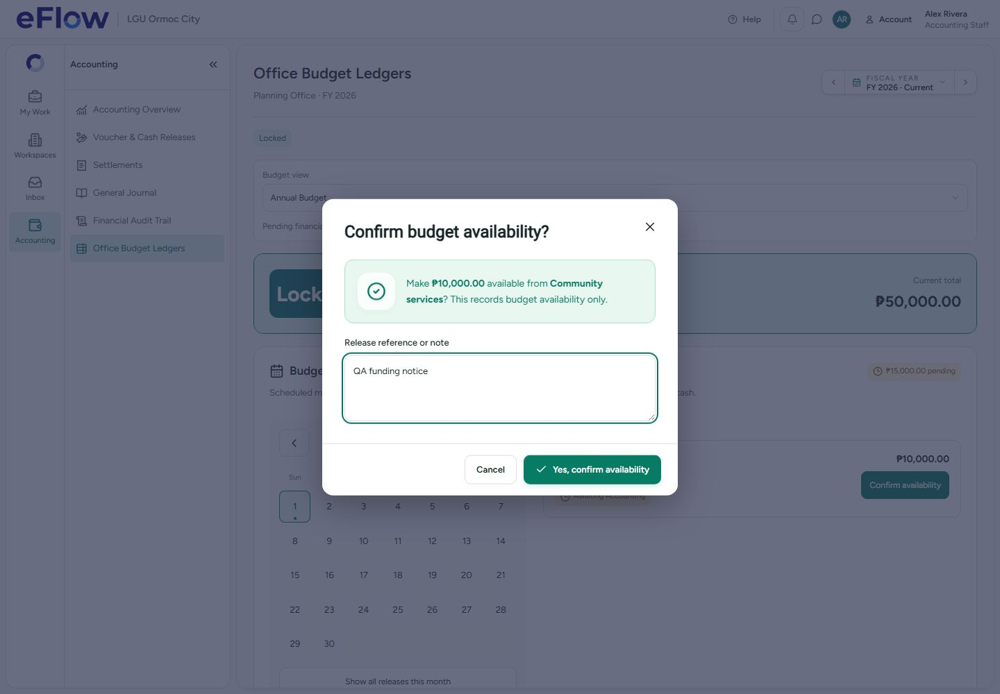

# Office budget release calendar and Q4 target

Status: implemented, tested and deployed to `ixnfphgjyelhckjwjkdv` after explicit user sign-off on 1 November 2026.

The Head can optionally set several release dates and amounts on each leaf account. The pending amount is calculated from the schedule. Accounting sees a month calendar in Office Budget Ledgers and confirms due releases with a reference and explicit confirmation. The same calendar is visible in the Office Budget overview and annual views. Physical cash release, petty cash and settlement are separate workflows.

After budget lock, the Head can reschedule releases and add held amounts, but cannot free pending money by deleting or reducing a schedule. Only Accounting confirmation makes it available. Confirmed entries retain the Accounting identity, time and reference and cannot be changed by the Head.

The Head can change the Q4 utilization target through Readjust budget. Valid values are 0–100%, up to two decimals. Changes require a reason, create an audited version and update the existing utilization warning logic. Accounting and Members cannot change the target.

## Validation

- Positive amounts in cents; schedule totals cannot exceed the account budget.
- Required, real dates within the selected fiscal year; distinct release IDs.
- Existing project commitments and settled spending remain protected.
- Accounting-only, active-office checks run in the database; future dates cannot be confirmed early (Asia/Manila calendar).
- Confirmation is serialized with Head edits. Stale revisions are rejected; repeating an already-confirmed release has no additional effect.
- Existing undated holds remain unchanged on deployment. The Head must assign dates when editing them; no dates or availability are fabricated.
- Confirmed release records, references and budget versions remain in history.

## Evidence

- 35 focused UI/selector tests passed.
- 31 native PostgreSQL checks passed in a rollback-only transaction, including actual project funding before/after availability confirmation. No QA rows persisted.
- Head and Accounting Chromium desktop cases passed at 1440×1000 with overflow checks at 1280×800. These use intercepted synthetic records, not hosted financial transactions.
- TypeScript and production build passed. Existing build chunk warnings remain.
- Graph refreshed with its four known partial-parser warnings.

## Hosted deployment package

Only `ixnfphgjyelhckjwjkdv` is targeted. Migration: `20261101130241_office_budget_release_calendar.sql`.

A verified database archive and password-free role archive are stored outside Git. The isolated migration workspace was populated from all 70 live migration versions. The dry run selected exactly this one delta, with no seeds, roles or history repair. The existing contents of 117 financial/application tables matched before and after preflight. The new column is excluded from row-content comparison so adding its empty default does not mask changes to existing values.

See `DEPLOYMENT_RECEIPT.json`, `INSTALLED_CHECKS.json` and `LIVE_READBACK.json`. The exact reviewed migration was applied after sign-off and renewed drift/preflight checks; all 31 installed checks passed with test writes rolled back. Read-only live checks confirmed correct calendar availability and Head/Accounting/Member capabilities. Existing data in all 117 checked tables remained unchanged. No invitation emails, passwords, accounts, existing budget amounts or cash transactions were changed. `SECURITY_ADVISORS.json` records the project’s existing advisory categories; none names the new release functions.
