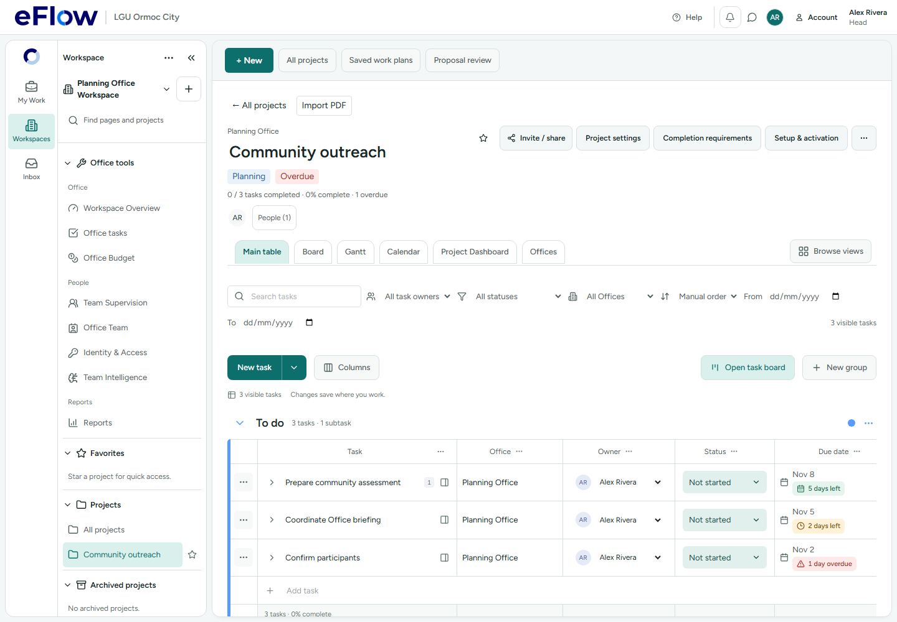

# Deadline indicators — 3 November 2026

Task and subtask deadlines now show a date and a compact urgency badge using the existing eFlow palette and icons:

- Green: more than 3 calendar days left.
- Yellow: 1–3 days left, or due today.
- Red: overdue, including an explicitly timed deadline that passed earlier today.
- Neutral: completed/cancelled work or no calendar deadline. Proposal-relative dates such as “Month 1” are not converted into invented deadlines.

Countdowns use Asia/Manila calendar days. Live badges update every minute and when the browser regains focus; users do not need to refresh. Labels accompany the colors. A date without a time remains due for the whole calendar day.

The badges appear in project task timelines, subtask tables and headers, task detail headers and the shared task board deadline presentation. Activity history preserves the original before/after dates, with “At change” marking urgency at the event time rather than treating an old recorded change as a current alert. No database records or notification delivery settings were changed.

Verification: 45 focused unit tests passed across deadline boundaries, midnight rollover, completion, historical changes, task date editing, hierarchy navigation and subtask expansion. A Chromium test passed at desktop widths of 1440px and 1280px, including a page-overflow check. TypeScript and the production build passed (existing chunk-size warnings remain). The prior action-header test expectation was updated to reflect the existing left-hand Actions column; this change did not move table actions.

