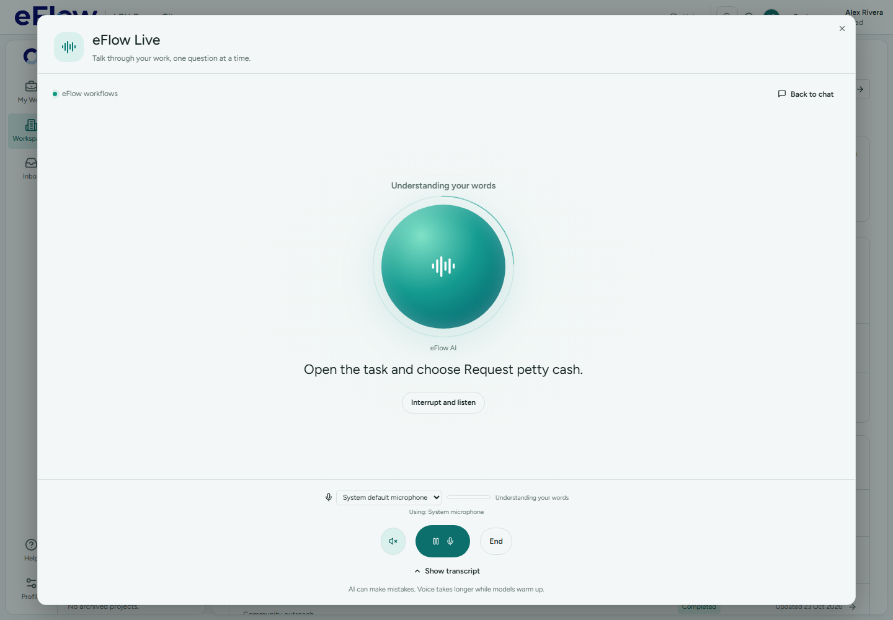

# Local two-second end of turn — 23 October 2026

eFlow Live now closes a speaking turn after **2,000 milliseconds of continuous local silence**, independently of Parakeet recognition. Resuming speech before that threshold resets the silence interval. A minimum of 250 milliseconds of detected speech is still required; the existing 20-second safety bound remains. Ordinary editable dictation keeps its existing segmentation and manual Finish action.

The microphone bar now uses the same speech threshold as turn detection. It shows Hearing speech, then Finishing your turn during a pause. As soon as the local turn ends, capture pauses, the meter becomes zero, and the status changes to Understanding your words while Parakeet finishes. Waiting for speech no longer appears during transcription, model processing or playback. Resume also clears stale meter values. Pause still controls input only.

Early transcription previews remain enabled and can be reused for the final audio. Recognition can take longer than two seconds; this change ends microphone capture and updates the UI, rather than claiming that recognition or the reply completes within two seconds. Detection follows received audio samples, so missing browser capture frames still require the existing microphone recovery path.

Validation: **37 unit tests passed**, covering two-second timing, speech restarting the interval, unresolved preview recognition, meter/status presentation, dictation, cancellation and Pause behavior. The desktop browser flow passed with the third transcription response deliberately held: it verified the finishing state before two seconds and a zero meter/transcribing state after two seconds, before releasing Parakeet's simulated response. This is synthetic capture/API evidence, not a physical microphone test. Logs and TypeScript/build results are saved alongside this report.

TypeScript check and production build passed. The build retained existing chunk-size and circular-reexport warnings outside this feature; no unrelated module changes were made.

