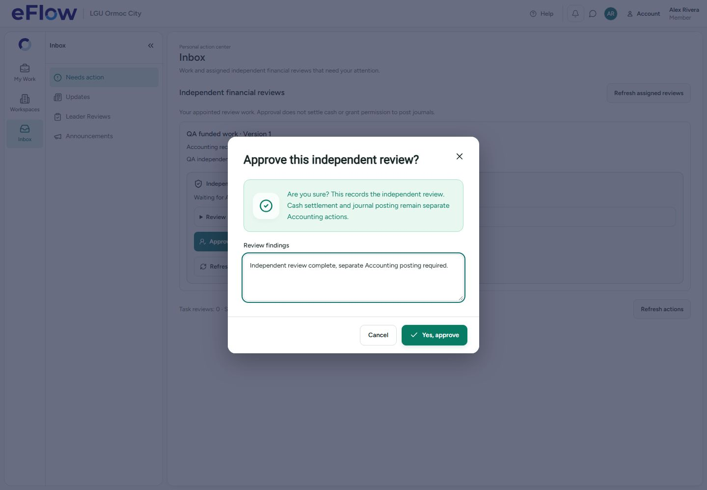

# Inbox decision dialogs — 1 November 2026

Approval uses green and a checkmark. Rejection and requested changes use amber and a return icon. Red is reserved for actual errors. Icons have a short entrance animation that respects reduced-motion preferences.

Task review, task-linked financial decisions, independent financial review, membership request decisions and office petty cash review now use centered confirmations with explicit Yes / Cancel actions. Notes and required reasons appear inside the modal. Existing permissions, cash-clearance checks, fresh independent-review checks and transaction retry identities remain in place.

Financial result messages no longer use a red banner for successful decisions. A successful decision remains successful when refreshing the queue fails, and its result stays visible if the last request leaves the queue. Errors retain the reason for correction and retry. Invitation approval does not send an email implicitly.

## Validation

- TypeScript check and production build passed. Existing production chunk-size warnings remain.
- Focused component tests cover cancellation without writes, required reasons, retained errors, success/return/error colors, empty-queue results, saved-write/failed-refresh handling, Head versus task-leader authority, independent-review freshness and membership capabilities.
- Chromium desktop Inbox acceptance passed at 1440 × 1000 using intercepted synthetic records. It verifies that the modal is within the viewport, no decision is written before Yes, findings are required, the review is saved once and Accounting posting permission is not exposed. The initial 30-second cold-start navigation timed out; the rerun with a 120-second allowance passed.
- Architecture graph refreshed. Its four existing partial-parser warnings remain; the graph is only a navigation aid.
- No live database changes or invitation emails were made for this UI work.

