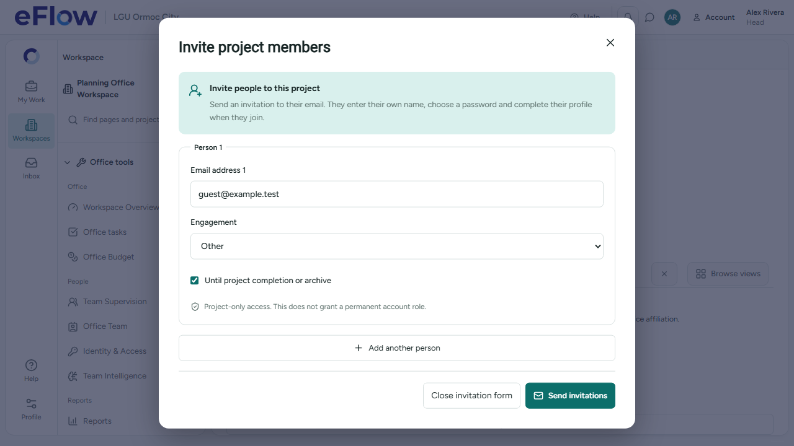
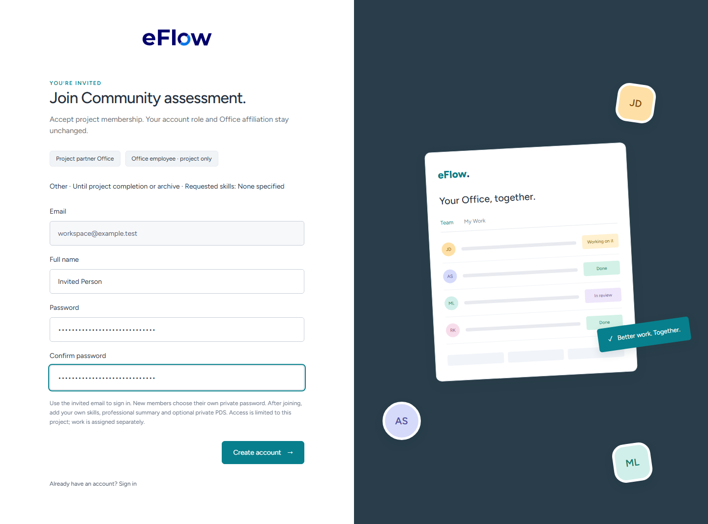
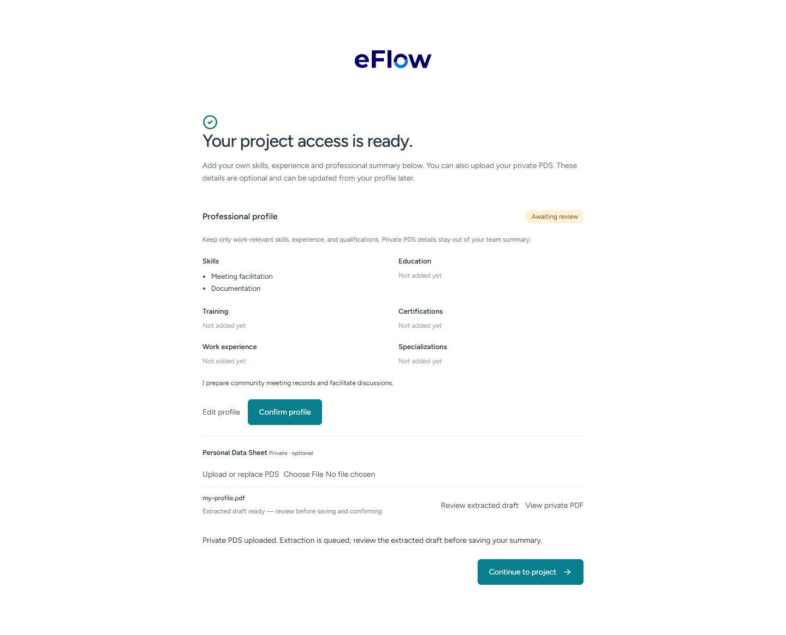

# Project invitations — 30 October 2026

Completed before the subitem-completion follow-up.

- Offices failed because an RLS expression queried the private project_invitation_requests table; the frontend also directly queried private project_guest_members. The new scoped r8_office_people API reads invitation/membership status with current actor authorization. A private recipient-only predicate fixes the old RLS expression. No private-table grants were widened.
- The current appointed sponsoring Head sees Invite project members / Send invitations. The explicit send action saves, approves through the existing server capability check and dispatches. Other scoped leads continue to request Head approval. Stable request IDs and server receipts prevent duplicate approval/email attempts on retry.
- Senders supply email and project engagement/access terms. Skills, professional summary, PDS, name and password belong to the recipient. New recipients choose their password, sign in with the invited email and fill their own professional profile after acceptance. The optional PDS upload is tied to the accepted request so a project-only guest does not need a permanent Office affiliation. Existing accounts retain their credentials and roles. Representative/employee labels describe project participation only.

## Verification

27 affected UI/service tests and 12 gateway tests passed. Desktop browser cases passed for direct Head sending, access terms, unavailable links, invited-email/password entry, recipient-owned profile saving and request-scoped PDS upload. The original legacy browser fixture used the retired Add view control; it now uses Browse project views. An exact-label accessibility issue on the Engagement select was also fixed. TypeScript and production build passed.

Hosted candidate checks reproduced the original permission error, then passed 10 rollback-only checks. After deployment, 9 installed-schema checks passed for Head access, recipient-only visibility, unrelated-user/anonymous denial and continued private-table denial. These are authenticated database-role checks, not a claim of a real browser/email login.

Migration 20261030010856_project_office_invitation_visibility.sql was applied once to ixnfphgjyelhckjwjkdv through an isolated workspace populated with all 60 prior live migrations. Fresh verified backup and policy snapshots remain in protected local storage. All 115 public tables matched their preflight hashes, excluding only the existing AI heartbeat row. Security advisors reported no added findings. Existing accounts, credentials and workflow records were preserved.

Local code graph refreshed; four existing parser warnings remain in guided-tours/index.ts, productivity/index.ts, project-table/components/ProjectTaskRow.tsx and work-templates/index.ts.

## Delivery verification

No real invitation emails were sent. The local configuration has a controlled test-recipient restriction enabled. Actual mailbox delivery and opening the email on the intended device remain user verification; provider acceptance alone does not prove mailbox receipt.

## Screenshots

