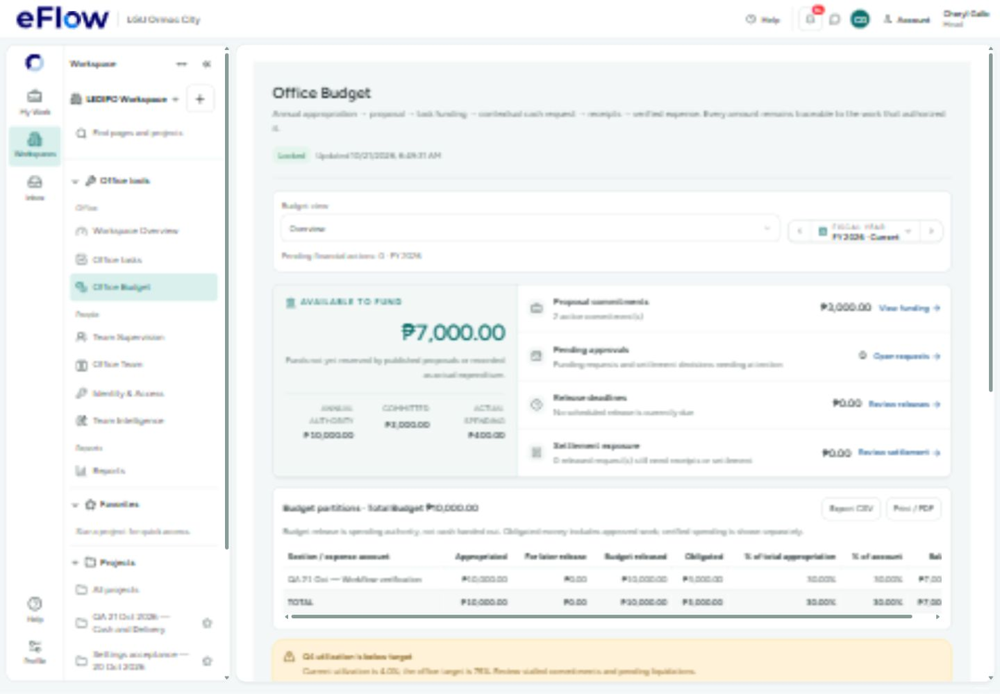
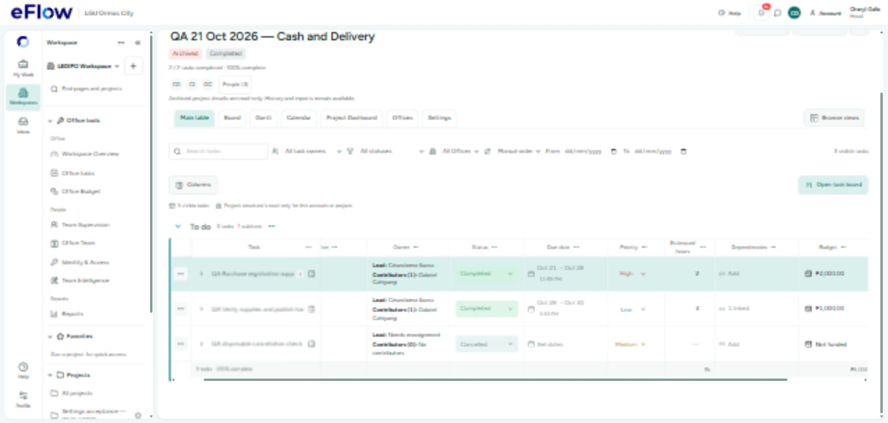

# eFlow desktop workflow QA — 21 October 2026

The project-to-archive walkthrough is complete. Fourteen reproduced defects were fixed. Two delivery tasks and their evidence approvals completed; the nested step passed through requested changes and resubmission. Petty cash passed through cancellation, rejection, replacement request, authorization, release, acknowledgment, itemized liquidation, return and independent accounting settlement. Archive → restore → completion → archive was verified.

[Open the 45-screenshot gallery](GALLERY.html) · [Detailed chronology](AUDIT.md) · [Hosted verification receipt](hosted-proof.json)

This is evidence for the scenario below, not certification of every account, tab, financial exception or concurrent-user condition in the system.

## Environment and final records

- Application: actual localhost:5173 UI; hosted data target **ixnfphgjyelhckjwjkdv** only.
- Desktop: 1440×1000 for the main walkthrough, 1918×914 for final archive checks. No browser zoom reduction. The browser's temporary viewport override was reset after testing.
- Accounts: Cheryl Gallo (appointed LEDIPO Head), Crisostomo Ibarra (task lead), Gabriel Cahiyang (assigned worker and independent Financial Officer). Development account switching used the visible login UI.
- Project: **QA 21 Oct 2026 — Cash and Delivery**, `2ee356d8-f77b-492a-9e22-9901a686a759`; final state **archived**.
- Final delivery: **2/2 required tasks complete, 100%**, one approved nested step. One additional unfunded disposable task is cancelled; another unstarted disposable task was soft-deleted and remains in history.
- All amounts and evidence are labeled QA fixtures. No real payment, purchase or invitation email was sent. Unrelated projects were not edited.

## What the Budget column now does

**Authorizing a task budget reserves Office Budget.** Entering a plan figure alone does not authorize spending. The table displays approved root funding, opens the existing funding authorization for the appointed responsible Head, and totals actual allocations. It no longer displays a disconnected estimate field.

| Budget fact | Verified amount |
|---|---:|
| FY2026 annual authority | ₱10,000 |
| Task 1 authorized budget | ₱2,000 |
| Task 2 authorized budget | ₱1,000 |
| Total committed | ₱3,000 |
| Available to fund | ₱7,000 |
| Released on the successful cash request | ₱500 |
| Verified expense | ₱400 |
| Returned unused cash | ₱100 |
| Unsettled cash / pending financial actions | ₱0 / 0 |

The ₱500 request used Task 1's existing pool. It did not reserve another ₱500 from annual authority. Cancelled and rejected requests restored their holds. Actual spending and obligations are separate measures; do not subtract the same ₱400 twice. Completion/archive preserve approved allocations and the fiscal audit trail; unused authorized amounts are not automatically released.

## Both delivery tasks used every supported column

| Column | Task 1: Purchase registration supplies | Task 2: Verify supplies and publish handover |
|---|---|---|
| Group | To do | To do |
| Office | LEDIPO | LEDIPO |
| Owner | Crisostomo lead; Gabriel contributor | Crisostomo lead; Gabriel contributor |
| Status | Not started → in progress → review → approved | In progress → blocker reported/cleared → review → approved |
| Dates | 21–28 Oct; default 23:59 deadline | 28–30 Oct; explicit 15:30 deadline |
| Priority | High | Low |
| Estimated hours | 2 | 3 |
| Dependencies | None; a proposed cycle was rejected | Task 1; final submission waited for its approval |
| Budget | ₱2,000 authorized | ₱1,000 authorized through the table cell |
| Progress | Approval-derived; 100% | Approval-derived; 100% |

The footer retains **5 hours / ₱3,000 authorized**. Cancelled work remains visible but no longer reduces required-work completion. No percentage slider was used.

## Defects reproduced and fixed

| ID | Observed defect | Implemented correction | Evidence / validation |
|---|---|---|---|
| B01 | Responsible appointed Head could fund in Office Budget but not from task Overview unless also task lead. | Separated fiscal oversight from execution membership; responsible Head, active-account and closed-work restrictions remain. | 07–09; caller permission regressions. |
| B02 | Confirmed schedule still instructed the Head to set project dates. | Confirmed readiness now says dates and schedule are valid. | 10, 37; readiness regression. |
| B03 | Excessive cash amount silently disabled submission. | Inline amount/source and duplicate-source explanation; server enforcement retained. | 12; over-pool request produced no write. |
| B04 | Rejected request hid the reviewer's reason. | Show decision feedback; distinguish new request after rejection from correction of the same request. | 15–17; terminal rejection retained. |
| B05 | Cash/funding controls used very small 8.8–10.5px text; authority refresh looked like an unexplained lock. | Scoped 12–13px text, larger buttons and draft-preserving refresh notice. | Funding/cash screens; draft-preservation and caller tests. |
| B06 | Manila's current release day was treated as tomorrow while UTC was still the previous day. | Shared Philippine date helper plus function-local Asia/Manila calendar for release, scheduling and release journal functions. | 18–20; the previously rejected normal release succeeded, without override. |
| B07 | Budget estimate cell/footer showed blank/zero despite authorized funding. | Rename to Budget; read approved ledger allocations; existing authorization dialog; one subscription per Office; no child-cap double count. | 24, 42, 44–45; six budget UI tests. |
| B08 | Saved dependencies did not prevent final submission/completion before prerequisite approval. | UI explanation and disabled submission; independent database trigger guards final states. Parallel preparation remains allowed. | 25, 29, 35; selector and transactional server checks. |
| B09 | Completion blocker directed Head to settle receipts owned by independent Accounting. | Correct pending-settlement guidance to Accounting → Settlements. | 26–27; separate Financial Officer settled the package. |
| B10 | Settlement journal business date used UTC. | Function-local Asia/Manila setting on settlement journal trigger. | 28; live function configuration checked. Historical QA journal retained unchanged; no second post-fix settlement was created. |
| B11 | Progress cell said Awaiting approval for unstarted/in-progress work with no subitems. | Use the current work-state label until it actually reaches review. | Five state-label regressions; cancelled label visible in 45. |
| B12 | Archived/read-only table advertised that changes would save. | Show the read-only message instead of autosave copy. | 39 before; 43/45 after; closed-project browser regression. |
| B13 | Board Manage opened Discussion instead of staffing. | Route its existing task entrance to Work, where team controls live. | Dedicated browser regression passed. |
| B14 | Cancelled task lowered table progress to 67% although required work was complete. | Exclude cancelled work from completion denominator; retain its row/history and show consistent collapsed summary. | 45: 3 visible rows, 2/2 required tasks and 100%; selector regression. |

## Workflow checks and negative paths

| Stage | Result |
|---|---|
| Budget setup | Held amount above appropriation blocked. Saved QA section and locked annual budget with confirmation. |
| Funding | ₱11,000 against ₱10,000 rejected; ₱2,000 then ₱1,000 authorized. Expense-account mapping set. |
| Planning | Project dates/team set; nested lead set; exact duplicate child rejected; cycle rejected; explicit/default due times persisted. |
| Execution | Lead/member roles exercised; blocker requires a reason; blocker saved and cleared; missing evidence disables final submission. |
| Nested review | Gabriel submitted; Crisostomo requested changes; second submission included the correction and was approved. |
| Task review | Self-review prevented; Head independently approved both tasks after cash clearance. |
| FR-00001 | ₱100 requested then cancelled; pool restored. |
| FR-00002 | ₱500 requested then rejected with reason; pool restored. |
| FR-00003 | Replacement ₱500 request authorized, released, acknowledged, liquidated and settled. No duplicate release. |
| Receipts | QA receipt, one item at ₱400, mapped expense account, ₱100 return reference. Journal debits/credits balanced. |
| Completion | Earlier open-work/cash blockers displayed; after reviews and settlement, completion passed. |
| Delete/cancel | Separate disposable unstarted task soft-deleted; separate unfunded task cancelled with a required reason. |
| Archive/recovery | Archive removed project from current list; archived page read-only; restore returned it to active; completed and archived again. |

## Code and hosted deployment

Principal implementation areas: `features/budget/components/ProjectTaskBudget.tsx`, cash/funding controls, `features/project-table/`, task inspector execution/summary, project readiness/closeout and Board task entrance. Existing financial RPCs are reused. No new RLS policy, financial API payload or server route was introduced by this QA slice.

Three reviewed migrations were applied only to the approved hosted target. Their actual live timestamps are preserved:

1. `20261020232324_cash_release_manila_calendar.sql`
2. `20261020234410_liquidation_manila_calendar.sql`
3. `20261020234944_task_dependency_final_review_guard.sql`

Live history was read into the isolated pending workspace `C:/Users/gabri/AppData/Local/Temp/eflow-qa-manila-migration-20261021`. Historical repository migrations were not pushed and the live migration ledger was not repaired. The new dependency trigger has a fixed search path and no direct anon/authenticated execute grant. Existing trigger bodies/grants were preserved for calendar corrections.

## Validation receipts

- **TypeScript:** `npm run check` passed; [log](check-final.log).
- **Production:** `npm run build` passed; [log](build-final.log). Existing large-chunk warning remains.
- **Full unit run:** 338 files / 2,055 tests; 2,041 passed and 14 exceeded the original five-second timeout. Every failed case passed when rerun serially with a 20-second timeout: [91 tests in 10 files passed](retests.log), including the dependency test. The original nonzero full-run result is retained in [unit-tests-final.log](unit-tests-final.log); this was not a new clean full-suite rerun.
- **Affected tests:** [30 passed](affected-tests.log), [26 passed](final-affected-tests.log), [15 progress/selector tests passed](progress-retests.log), [six final budget tests passed](budget-final-tests.log). These overlapping runs are not summed as a unique test count.
- **Chromium regression:** all 14 distinct scenarios passed across the final runs: nine main-table scenarios in [retest](playwright-retest.log), plus budget/Board/closed-project scenarios in [final](playwright-final.log), with the final budget reload persistence check passing [here](playwright-budget-persistence.log). Earlier failures were cold-load timing and two stale drawer-close expectations; updated tests wait for loaded content and use the actual task page's Back to project control. Original failed-run logs are retained. Desktop was the manual acceptance target; existing synthetic tests also cover narrow layouts.
- **Graphify:** local update completed; [log](graph-update-final.log). It reports four partial AST extraction warnings (guided-tours, productivity, ProjectTaskRow and work-templates). TypeScript/build passed; the graph is not treated as complete proof for those files.
- **Hosted security advisor:** [receipt](security-advisors.json). New dependency guard was not flagged. Existing search-path, definer-grant, extension, policy-less RLS and password-protection notices remain; this walkthrough did not change their access model. [Search path guidance](https://supabase.com/docs/guides/database/database-linter?lint=0011_function_search_path_mutable), [definer grant guidance](https://supabase.com/docs/guides/database/database-linter?lint=0028_anon_security_definer_function_executable).

## Remaining improvements and coverage limits

1. **Budget closeout UX:** show unused authorization separately and provide an explicitly reviewed release/adjustment path. Today the ₱3,000 commitments remain after archive; ₱400 actual spending is recorded separately. Automatically freeing funds would change fiscal policy, so it was not inferred from project completion.
2. **Office tasks readability:** its retained legacy list shows verbose hierarchy/audit text and raw ISO deadlines. Align it with the main table's concise date/team presentation in a separate UI slice.
3. **Readiness density:** collapse confirmed checks and lead with unresolved actions. The expanded list remains long even when 9/9 are confirmed.
4. **Startup performance:** the large workspace bundle and cold development transforms can exceed short browser-test waits. Split the shared workspace bundle in a separate no-feature-loss change; longer fixture waits do not improve production performance.
5. **Calendar correction acceptance:** normal cash release was retested live after its fix. The settlement journal correction was verified in deployed configuration, not by generating a second settlement. The pre-fix immutable QA entry still has the prior UTC date and is disclosed as evidence, not rewritten.
6. **Not exercised in this scenario:** permanent project purge, actual invitation delivery, cross-office guest acceptance, AI/PDF import, account administration, budget fiscal close, multi-day split release/override, correction of the same cash request, liquidation rejection/resubmission, every report/export and multi-user races. Soft delete, terminal cash rejection followed by a new request, child evidence rework and normal settlement were exercised. These distinctions matter; they are not equivalent paths.

