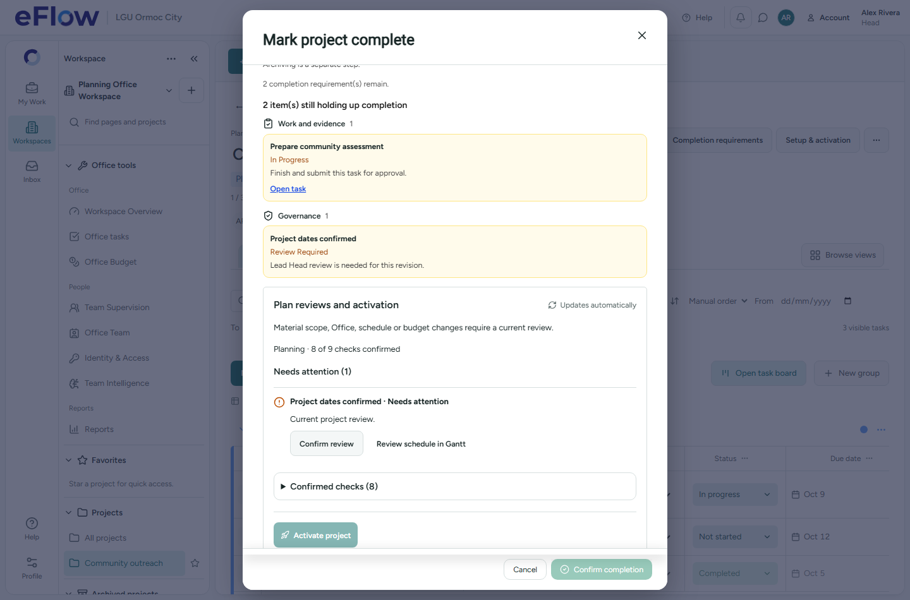
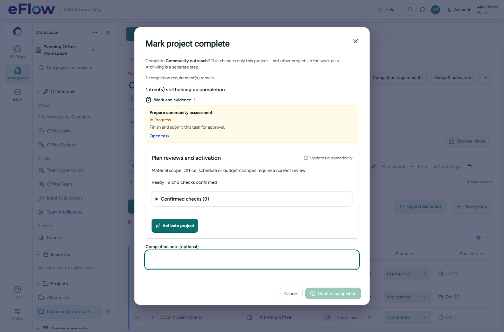

# Automatic checks and activation spacing

## Requested change

The activation action touched the Confirmed checks disclosure in Completion requirements. Routine Refresh plan reviews / Refresh checks buttons also made users manually reload facts that should update automatically.

## Implementation

- The normal readiness card now uses a flex layout with consistent gaps and a separated activation footer: top border, padding and spacing below confirmed checks. The activation action has the existing icon style.
- Both readiness presentations show a noninteractive automatic-update status instead of a refresh button. Completion's routine refresh button is removed too. Retry controls appear only on actual errors.
- Readiness, its summary and completion availability use `subscribeProjectChecks`. All handlers are registered before subscription, and each mounted consumer retains its unique channel and guarded cleanup from the crash fix.
- Project/review/task/Office changes are project-filtered. Published child membership, subtask, cash-request/liquidation and allocation events use existing Realtime RLS visibility to invalidate only the current authorized project RPC result; no broader read grants are added.
- Bursts are coalesced for 150 ms. Reconnect, focus, online and visible-tab recovery refresh automatically. A visible-tab 15-second fallback covers missed/unpublished events and socket outages. Cleanup removes timers/listeners and prevents late callbacks.
- Background readiness reads retain already displayed checks while checking; review/activation actions remain disabled until the current read succeeds. Explicit Head decisions and server action-time validation remain mandatory. No review, activation or completion is submitted automatically.

No database migrations, policy changes or workflow data edits were needed for this UI follow-up.

## Verification

- **44 focused tests passed / 7 files**: input subscriptions, current-project filters, event coalescing, fallback, reconnect, teardown, StrictMode/concurrent panels, scope/freshness, preserved completion authorization and existing settings behavior (`automatic-readiness-tests.log`).
- Chromium reopening regression passed for Setup, Completion and Settings with no uncaught page errors.
- Chromium Realtime scenario passed: backend fixture review changes moved the panel from 8/9 to 9/9 with no refresh click and no automatic decision writes. Activation was at least 16 px below the confirmed-check disclosure. Completion-blocker refresh and screenshots use the same scenario (`automatic-readiness-visual.log`). Browser backend records/events are intercepted fixtures, not hosted mutations.
- TypeScript, production build and whitespace checks passed. Screenshots were inspected at 1440×950, using the 672-pixel modal width matching the reported layout. The confirmed-check disclosure and activation action are visibly separated by spacing and a divider.
- The local code graph refreshed after the subscription/API extraction. Four existing parser warnings remain on unchanged barrel/ProjectTaskRow files; no forced rebuild was used (`automatic-readiness-graph.log`).

