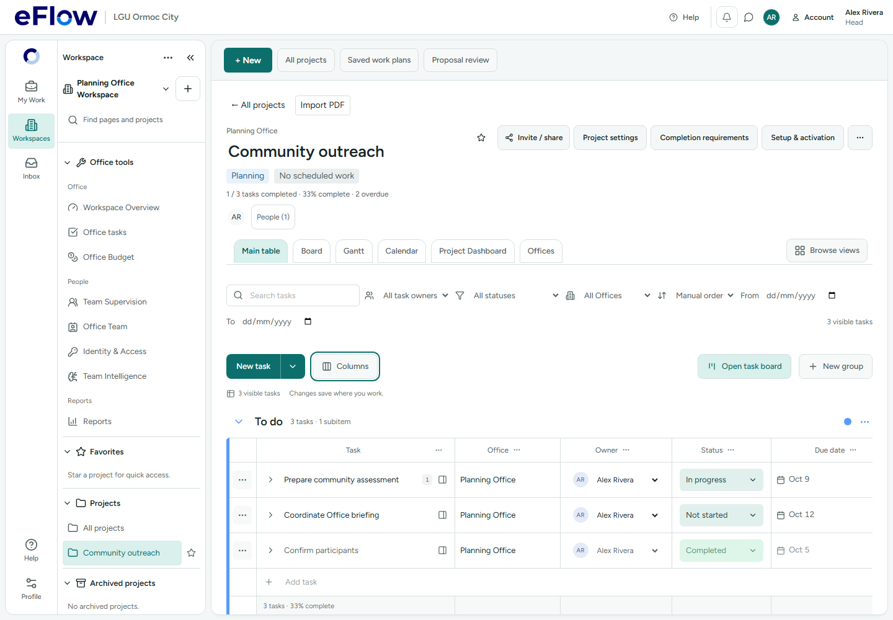
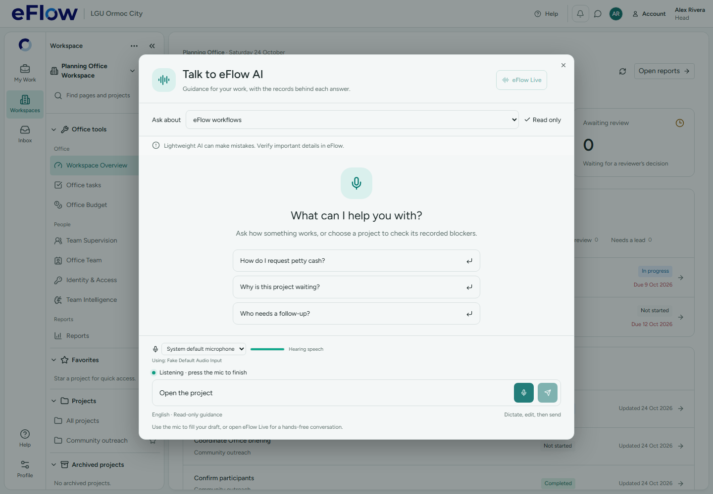

# 24 October source-plan review and implementation

**Later continuation:** the separately approved cleanup and hosted financial deployment are recorded in [the live workflow audit](live-flow/REPORT.md). The no-hosted-writes statement below describes this earlier source-plan phase only. The leadership migration remains undeployed.

Implementation is local. **No hosted migration, account/office mutation, invitation email or financial transaction was performed.** The only hosted access was a read-only function/trigger/migration inventory on `ixnfphgjyelhckjwjkdv`. The supplied ZIP-based plan was checked against both Windows checkouts and the installed SQL catalog.

- [Reviewed source plan](REVIEWED_SOURCE_PLAN.md)
- [Original issue handoff](ISSUES_FOR_AI.md)
- [User-owned manual acceptance](MANUAL_VERIFICATION.md)

## What the review changed

| Plan area | Finding and implemented result |
|---|---|
| H01 leadership | The plan omitted the installed `guard_super_admin_task_mutation` trigger. Its SQL would still fail there. The broad nested-work early return was also unnecessary. The actual fix authorizes exact routing rows through a private transaction-bound capability, including the Admin guard, while retaining subsequent operation/invariant checks. |
| VOICE-01 speech | Existing chunk prefetch and F16 workers were already present. Added stage timings and immediate queue/proxy completion wakeups; retained the working model and chunk boundaries. This removes polling overhead, not the model's generation cost. |
| VOICE-02 transcription | Cancelling every preview would discard a reusable identical final blob. Only obsolete previews are aborted, accepted finals are preserved and late aborted responses are ignored. Since browser abort does not prove server inference stopped, the server admits one waiting transcription instead of losing the following final to a transient busy response. |
| BUILD-01 cycles | Captured a fresh build and source import graph. Deferred workspace screens and asynchronous service calls at existing feature boundaries, preserving public imports and synchronous small controls. Circular-chunk warnings are removed. Added named-export retry facades for three modules also used by static callers. |

## Leadership repair

Migration: `supabase/migrations/20261024002339_leadership_default_review_reroute.sql`, created with Supabase CLI. It has **not been applied to the hosted target**.

The [captured installed catalog](leadership/installed-task-catalog.json) contains function/trigger source, not project/account rows. The migration compares the four prerequisite definitions and aborts on drift. Historical files, function signatures and existing public owners/grants remain unchanged.

`eflow_leadership.reroutes` is private, has RLS and grants no client table access. Only the leadership RPC owner records the exact actor, transaction, task and old/new reviewers. Its predicate permits no task-content, status, staffing or other field changes. Capabilities are removed before successful return and roll back with failed transactions. No session flag, trigger disabling or general Admin write permission is introduced.

The RPC writes canonical reviewers before task authorization triggers evaluate the new row. It skips unchanged rows, custom routes, finalized/deleted tasks and closed-project history. Existing validation still prevents clearing the Head of valid default-routed work awaiting review. Office/profile/routing/audit changes remain one transaction. The audit includes affected task IDs.

Two local test harnesses reproduce the old failure before applying the repair:

- `node scripts/verify-leadership-reroute.mjs`: **114 checks passed**, including definition drift, ACL preservation, RLS, denied forged capabilities, task-field tampering, rollback, pending reviews and archive history. [Receipt](checks/leadership-local.log).
- `server/.venv/Scripts/python.exe scripts/verify-leadership-reroute-native.py`: **16 native PostgreSQL checks passed**, including independent sessions serialized through commit. [Receipt](checks/leadership-native.log).

Deployment must use a fresh isolated live-history workspace and review the pending October 21 financial package separately. Never push the historical migration directory. Signed hosted leadership acceptance remains a manual gate.

## Speech and transcription

Frontend: `services/progressiveTranscription.ts`. Gateway: `server/routers/help_assistant.py`. AI host: `server/help_assistant/{speech_service,kitten_process,parakeet_runtime,job_completion,latency}.py` in `C:/Users/gabri/OneDrive/Desktop/Ollama reactjs LLM DeepSeek Integration`.

The ASR admission bound is one active request plus one waiting request; excess admission remains explicit. Cancelled waiters cannot release another request's lock. A cancelled preview cannot publish or cache stale words. The existing identical-blob reuse, three-final browser queue, two-second local silence detection and no-cancel policy for accepted finals remain intact. This does not turn Parakeet into native streaming ASR or guarantee cancellation of computation already inside it.

Text/speech jobs now wake on the queue's existing owner-scoped completion event. The gateway also wakes on the proxy response. The old 250 ms core and 200 ms gateway polling intervals no longer impose their full polling delay on completed replies. Disconnect checks, deadlines, original JWT forwarding, role/source rechecks and cancellation cleanup remain.

Timings separate Kitten worker startup from token generation and retain the legacy `tokens_seconds` field. New duration-only logs distinguish ASR admission wait, worker request time, Parakeet startup and inference HTTP time. No prompts, transcripts, audio or credentials enter those diagnostic records. Pause still controls microphone input only; Interrupt/End retain cancellation semantics. Qwen, the tiny Live model, actual LAYA staffing, F16 speech weights and checked workflow knowledge were not replaced.

### Actual runtime measurements and remaining cost

[Uncached runtime receipt](runtime/uncached-runtime.json): three cold/warm pairs per model, using owned local processes, validated WAV output and synthetic input. The AI HTTP server and Ollama were not running when these direct model probes began. Other build/browser/test work ran concurrently, so this is an exploratory runtime profile, **not a controlled before/after speedup or a physical speaker benchmark**.

| Probe | Cold seconds | Warm seconds |
|---|---|---|
| Kitten, 28-character phrase, F16 | 44.625 / 33.047 / 30.125 | 5.015 / 4.765 / 4.265 |
| Parakeet, 5.48-second synthetic WAV | 6.625 / 5.219 / 5.016 | 3.375 / 4.344 / 6.656 |

All six ASR requests returned recognized text; this does not establish transcription accuracy on a user's actual microphone. All six TTS generations were uncached. Warm audio lasted approximately 2.36–2.68 seconds, so generation can still be slower than playback and gaps remain possible. The shorter October 23 ASR receipt used a different clip length and cannot be directly compared as a speedup.

Cold startup and F16 token throughput remain real limitations. This patch does not claim to solve them through a smaller chat model, shorter misleading fragments, invalid Q4 sampling or a cache hit. Physical audible timing, microphone quality, Cloudflare and concurrent real model workloads remain in the separate manual checklist.

Backend regressions: **68 AI-host tests passed**, including admission bounds/cancellation, queue completion, worker reuse/F16 selection, privacy, access checks and existing model routing. [Receipt](checks/ai-server.log). **Two gateway completion/session/cancellation tests passed**. [Receipt](checks/gateway.log).

## Build and view loading

Fresh [before](checks/build-before.log) and [after](checks/build-after.log) builds are retained. The largest minified chunk fell from approximately **1,407 kB to 733 kB** (about 48% raw reduction). This is a maximum-chunk comparison, not an assertion about every route's download.

Cross-feature imports still use feature public APIs. Expensive workspace screens use the existing `lazyFeature` boundary; async service operations import their feature API when needed. Small staffing/tree controls were kept synchronous after interaction regressions exposed the cost of deferring them. A new regression test proves member data can be read without evaluating the member screen. The review permission test now waits for the intentionally deferred review workspace before asserting the same permissions and zero unauthorized writes. [Boundary receipt](checks/member-review-boundary.log).

Retry names were added to the existing manifest without changing its string-to-asset format. Strict named-export facades preserve retry imports for views shared by static and dynamic callers.

All 12 new retry assets were found in the build. The dedicated production-preview import test is written but was **not run**: automatic approval review rejected the preview-start command, stating only “blocked by policy.” Keep this browser import check in manual acceptance; static asset presence does not prove a successful browser import.

Large chunks remain: the core Supabase/React bundle, the board's rich-text dependencies and PDF.js. Mixed static/dynamic-import informational warnings also remain; they are distinguished from the removed circular-chunk warnings. No warning threshold was raised. Graphify refresh retains its four existing partial-parser warnings.

## Browser evidence and limits

The broad intercepted Chromium run had **seven passes and four failures**. Passed cases include desktop Help layouts/themes, dictation/Live/Pause/End, the real browser media graph with synthetic audio, and inline task saving. [Full receipt](checks/browser-broad.log).

The two failing desktop cases were also exercised against HEAD source substituted read-only into an isolated Vite instance, without resetting the shared checkout. Both failed at the same interaction: flat subitem save and a legacy Board lane target. These are pre-existing compatibility/fixture investigations, not silently counted as passes. [Before comparison](checks/browser-before-comparison.log). The two broader mobile cases were not certified by this desktop slice.

Current desktop table coverage: layout/column persistence, filter chips, Observer/closed-project read-only access and Board Manage passed. Head appointment retry passed separately after a Vite-config restart interrupted its first attempt. [Desktop receipt](checks/browser-desktop.log), [appointment recheck](checks/browser-owner-recheck.log). These tests use synthetic backend interception, not signed hosted acceptance.

## Final gates and manual handoff

The full repository test run is recorded separately; it must not be represented as green while any timeout/failure remains. The depth-eight collapsed-readiness test exceeded its original five-second deadline under concurrent checks; isolated rechecks and the final full-run result are recorded in the validation status receipt. No global test timeout was increased.

The user retains hosted workflow verification: Office Budget/commitments/cash/settlement, project-only invitation acceptance, Qwen → LAYA membership persistence, physical/remote speech and installation acceptance. No live PDF import was repeated. Optional funding presentation, spoken barge-in, backup-role policy and broader assistant data access were not implemented as bug fixes.

The plan's additional multi-call client risk also remains separate: `OrgModal` can save office details before leadership fails, and managed-user edits can complete some office changes before a later profile save fails. This migration makes the leadership RPC atomic, not an entire sequence of separate client calls. Explicit partial-success receipts or a separately governed atomic operation need their own source slice.

See [VALIDATION_STATUS.md](VALIDATION_STATUS.md) for final command results and [MANUAL_VERIFICATION.md](MANUAL_VERIFICATION.md) for the user's acceptance list. The AI host and gateway must load their updated code before remote testing; the web checkout alone does not provision the separate speech runtime.
