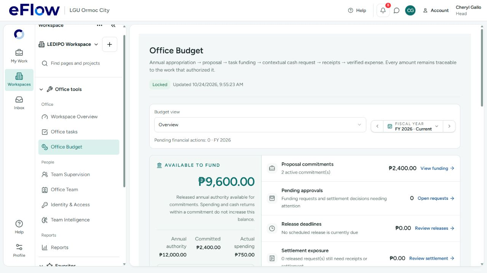
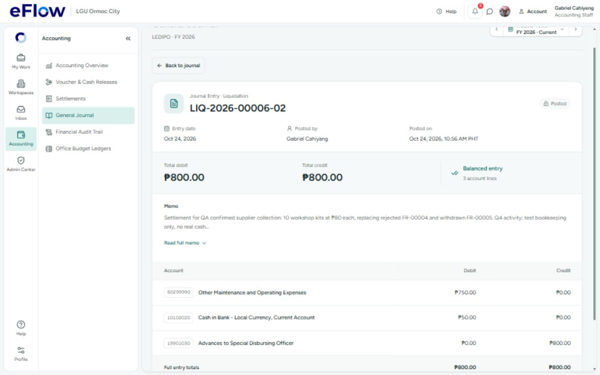

# Completed desktop workflow audit — 24 October 2026

**Result:** one realistic hosted budget → task funding → petty cash → receipt correction → Accounting settlement → delivery review → project completion/archive flow passed. Six encountered findings were corrected. This is evidence for that flow, not certification of every system function.

- [Screenshot gallery](GALLERY.html)
- [Remaining work and unverified acceptance](REMAINING_GAPS.md)
- [Separate user verification checklist](../MANUAL_VERIFICATION.md)
- [Final database checkpoint](FINAL_CHECKPOINT.json)
- [Exported budget CSV](budget-utilization-2026.csv)
- [Screenshot file sizes and SHA-256 manifest](SCREENSHOT_MANIFEST.json)
- [All audit reports](../../QA_AUDITS.md)

## Scope, actors and preservation

The visible desktop browser used the local frontend/gateway against **ixnfphgjyelhckjwjkdv only**. Workflow records were created through the application, not randomly seeded. SQL was used for readback and explicitly labeled rollback-only guard probes; it was not substituted for the signed-role cash flow.

The user explicitly authorized clearing workflow data and preserving LEDIPO, all eight accounts/credentials/skills and every Admin account. That reset was completed once, before this new scenario. **Do not replay it.** The retained QA project and all new financial history are available for review.

| Actor | Use in this run |
|---|---|
| Cheryl Gallo — existing Head | Quarterly plan, project/team/dates, task authority, cash decision, independent delivery review, completion/archive |
| Crisostomo Ibarra — existing Member | Task lead and cash recipient; cash requests/withdrawal, receipt packages and delivery evidence |
| Basilio Santos — existing Member | Selected project contributor on both tasks |
| Gabriel Cahiyang — existing Accounting Staff | Independent cash release, receipt corrections, expense mapping and settlement/journal posting; not a member of the delivery team |

No account password, email, skill or Admin role was changed. No invitation email was sent. Help/Live, real speech and PDF import were excluded as requested. All amounts and evidence below are labeled QA bookkeeping; no real cash transfer or real-world attendance certification occurred.

### Reset and private backups

Cleared 115 reviewed workflow tables in one explicit allowlist transaction with RESTRICT, without altering RLS, triggers, schemas or migration history. Canonical fingerprints for 21 protected identity/configuration tables matched. Retained eight accounts, one Office and both workspaces. Login/session activity can change normally during subsequent sign-ins.

Before removal, all 13 old work/receipt Storage objects were downloaded and SHA-256 checked (300,833 bytes). The avatar and profile/PDS material were preserved. A verified custom database archive and password-free role export were kept in private local application-data deployment backups, outside this repository. [RESET_RECEIPT.json](RESET_RECEIPT.json) contains the sanitized receipt. Private backups and signed receipt URLs are not served with this audit.

Screenshot 01 is the **old pre-reset** ₱10,000/₱3,000/₱400 baseline. It must not be confused with the new ₱12,000 plan below. Screenshot 02 records the clean dashboard.

## Financial result and what task Budget actually does

**Authorizing task Budget commits Office authority once. It does not mean cash was released or spent.** Rejection, withdrawal, re-request, release and settlement did not create another task commitment. Returning cash did not silently increase uncommitted annual authority. Archive retained the commitments and history.

| Final measure | Amount / result |
|---|---:|
| FY2026 annual authority, locked | ₱12,000 |
| Task commitments | 2 / ₱2,400 |
| Available Office authority | ₱9,600 |
| Q4 authority / committed / available | ₱3,600 / ₱2,400 / ₱1,200 |
| Cash released on FR-00006 | ₱800 |
| Verified actual expense | ₱750 |
| Returned cash | ₱50 |
| Outstanding released cash awaiting settlement | ₱0 |
| Net released cash after return | ₱750 |
| Unused authorized task funding retained | ₱1,650 |
| Final project | Archived; 2/2 tasks approved, 100% |

The ₱1,650 is retained unused authority (₱2,400−₱750), not cash in the recipient's hands. An audited commitment release is a separate operation; archive does not perform one. The final Office Budget UI explains this distinction. Its CSV totals match the screen and hosted checkpoint.

## Realistic quarterly setup and task execution

Created and locked this plan through the UI. The parent aggregates children once; prior quarters are planning allocations, with no invented backdated spending.

| Quarter | Planned activity | Authority | Committed |
|---|---|---:|---:|
| Q1 | Enterprise needs assessment | ₱2,400 | ₱0 |
| Q2 | Entrepreneurship training materials | ₱3,000 | ₱0 |
| Q3 | Local product packaging support | ₱3,000 | ₱0 |
| Q4 | Year-end market-readiness workshop | ₱3,600 | ₱2,400 |
| Total | LEDIPO community enterprise support | ₱12,000 | ₱2,400 |

Daily cash ceiling: ₱1,000; per-receipt threshold: ₱500; liquidation term: 15 days; target utilization: 75%; receipt override off. The expected low-utilization warning remains visible; it is not a failure or fabricated spend.

Project: **QA 24 Oct 2026 — Q4 Enterprise Market Readiness**, October 24–30, ID `0708b789-e91c-4b2f-93b3-9e779e336797`. Two tasks used Office, lead/contributor, status, timeline, priority, estimated hours, dependency, Budget and progress. The dependency column legitimately has no prerequisite on the first task.

| Task | Schedule / hours / priority | Authorized Budget | Execution result |
|---|---|---:|---|
| QA Purchase workshop participant kits | Oct 24–27 / 4h / High | ₱1,800 | 10 paired kits shared by 20 QA participants; ₱750 verified expense; independently approved |
| QA Verify kits and complete workshop handover | Oct 27–30 / 2h / Medium | ₱600 | Depends on procurement; inventory/hand-over evidence; no additional cash required; independently approved |

Both tasks used Crisostomo as lead and Basilio as contributor. Project participants and plan reviews persisted. All three current plan reviews were confirmed before activation. A later structure change correctly put the project on hold; current reviews and the existing Settings activation route restored it. Setup/activation remained hidden while Active. Gantt displayed actual dates and their same-day overlap, rather than silently inventing a sequential schedule.

## Signed-browser walkthrough results

| Step | Actual result | Evidence |
|---|---|---|
| Quarterly plan save/lock/reload | Pass: four partitions and parent total persisted | 04; hosted readback |
| Authorize both task Budgets | Pass: exactly 2 commitments / ₱2,400; annual available ₱9,600 | 05; checkpoint |
| Over-budget cash request | Pass: ₱2,000 rejected against the task's ₱1,800 authority | Browser validation |
| Reject first quote | Pass: FR-00004 ₱900 rejected with specific revised-quote feedback visible to requester | 06–07 |
| Re-request and withdraw | Pass: FR-00005 ₱800 cancelled before approval; task requestable funding restored to ₱1,800 | 08 |
| Final request/Head decision | Pass: FR-00006 ₱800 authorized; one October 24 tranche below daily limit; Head has no release control | 09 |
| Accounting release/recipient acknowledgement | Pass: one ₱800 release, release journal balanced; recipient acknowledged | 11; hosted totals |
| Receipt upload | Pass: two actual hosted uploads: notebooks ₱400 and folder/pen sets ₱350; cash return ₱50 | 13, 22–23, 26 |
| Request receipt correction | Pass: Accounting requested inventory reference; v1 retained as changes_requested; feedback visible | 21 |
| Resubmit corrected package | Pass: v2 cites QA-HANDOVER-001, same original receipt totals; approved independently | 22–23, 29 |
| Authorized attachment preview | Pass: Accounting opened stored receipt image in browser; no signed URL copied to docs | 26 |
| Missing journal mapping | Expected server rejection exposed a retry-classification bug; fixed, then configured Q4 mapping through UI | 27–28 |
| Settle/post | Pass: exactly one settlement journal; request settled, ₱750 spent and ₱50 returned | 29–31; checkpoint |
| Delivery review with unsettled cash | Pass: independent Head approval blocked while cash open; no self-approval for Member | 24–25 |
| Delivery review after settlement | Pass: clearance refreshed; Head approved procurement, then dependent handover | 32–34 |
| Complete project | Pass: zero remaining requirements, 9 current checks, then Completed / 100% read-only | 35; checkpoint |
| Archive project | Pass: moved out of current list into Archived projects; work/history retained and read-only | 36–37; checkpoint |
| Supported cleanup controls | Pass: temporary empty group deleted; temporary unstarted task soft-deleted; financial records retained | Hosted soft-delete readback |
| Budget CSV export | Pass: downloaded real export; annual ₱12,000/₱2,400/₱9,600 and Q4 ₱3,600/₱2,400/₱1,200 match | budget-utilization-2026.csv |
| Completed Office task layouts | Pass at 1440×900 and 1280×720; readable task names, team, status and dates | 38–39 |
| Project dashboard | Pass: 2/2 approved, 100% delivery; ₱750 settled / ₱2,400 authorized funding (31%) | 40 |
| Calendar and Board | Pass: October 27/30 due dates and project dates retained; both cards in Completed, mutation controls disabled | 41–42 |

Receipt form and completion views were also checked at 1440×900 and 1280×720. Actual browser zoom combinations were not exhausted. The older tab's screenshot/pointer control stopped responding after an app/server restart; a fresh tab in the same visible browser restored input. This was an automation recovery, not established as an eFlow source defect. The local dev server was restarted; cold module loading alone is not treated as a reproduced product defect.

### Journals and configuration

Q4 was explicitly mapped in Accounting's Office Budget Ledgers view to the existing catalog expense account **50299990 — Other Maintenance and Operating Expenses**. No fallback account was invented to bypass validation. The annual partition's legacy display code 501 is separate from the posting mapping. Q1–Q3 remain planned/unspent and were not given arbitrary posting mappings.

Release and liquidation each have total debits **₱800** and credits **₱800**. Settlement debits expense ₱750 and returned cash ₱50, and credits advance ₱800. Both are dated October 24 in Manila. Journal numbers 3 and 5 are not duplicates; rollback can consume sequence values. Final tables contain exactly two posted entries. Journal history is read-only.

### Dependency enforcement (separate from browser evidence)

With both tasks completed, authenticated Head database-role calls to `transition_task_status` (reopen prerequisite) and `soft_delete_task` were rejected with SQLSTATE 22023: submitted/approved dependents must be reopened first. Both transactions rolled back; no completed work changed. A zero-row Member direct UPDATE and the mandatory-transition guard were not counted as proof of this rule. [dependency-guard-probes.json](dependency-guard-probes.json) records the corrected probes. This is not a signed-browser reopen/delete test.

## Encountered findings and fixes

| ID | Trigger and actual behavior | Correction and validation |
|---|---|---|
| QA24-01 | Open Annual Budget with an initial failed network read. The page showed “Budget data unavailable” but also ₱0 and “No annual budget has been saved,” although the saved budget was ₱12,000. | `OfficeBudgetWorkspace.tsx` now suppresses the initial annual editor/empty state when the budget read failed and no summary is available. Retry remains. Regression plus annual-budget tests passed: 2 files / 9 tests. TypeScript and production build passed. The original fetch failure recovered on Retry; its transport cause is not established. |
| QA24-02 | Accounting's voucher/release screen displayed “Funded work” even though an authorized direct-work commitment contains the task name. Operational task RLS correctly hides the task row from Accounting. | The financial bundle now falls back to the already-readable **direct-work commitment** title when the operational task name is unavailable. Current task names take precedence; proposal titles are never substituted. Six financial-bundle tests passed, including Accounting restriction, name precedence and proposal exclusion. No permissions were expanded. Live Accounting readback now shows the correct work name (screenshot 14). |
| QA24-03 | With two itemized receipts at desktop size, the liquidation modal's header and Close control moved out of view; the middle grid track expanded with content. | Give the modal explicit `auto / minmax(0,1fr) / auto` rows so its body scrolls within the viewport while header/footer stay accessible. Verified on the real corrected two-receipt form at 1440×900 and 1280×720: header, Close and submission footer remain in view while the body scrolls (screenshots 22–23). |
| QA24-04 | The actual Accounting settlement screen could not load `get_liquidation_independent_review`, disabling both correction and settlement. The financial frontend had been implemented before its two required hosted migrations were installed. | After explicit user deployment approval, compared 14 affected definitions/ACLs with the captured baseline (no drift), verified a fresh private backup, populated an isolated workspace from all 56 live migrations and applied only `20261021172003` and `20261021175217`. All 116 pre-existing public/account tables retained identical fingerprints. No historical timestamps were repaired; no seed or role script was run. See `DEPLOYMENT_PREFLIGHT.json` and `DEPLOYMENT_RECEIPT.json`. Signed browser acceptance continues below. |
| QA24-05 | Settling a receipt source with no active journal mapping correctly returned a validation rejection, but `financialFailureIsUncertain` mislabeled that clear result as uncertain and blocked retry. | Classify this exact mapping rejection as a known server rejection, while keeping network/timeouts/unknown results uncertain. Added classifier and actual settlement UI retry regressions. Mapped Q4 to the existing approved catalog account in the UI; subsequent settlement posted exactly one journal. No fallback account or validation bypass was introduced. |
| QA24-06 | The task decision textarea and cash-decline reason had placeholders but no accessible field names. The real browser accessibility tree exposed unnamed inputs. | Added explicit approval/change-feedback and cash-correction accessible names. The cash-aware review interaction regression now locates required feedback by its name; nine review tests passed. |

The QA24-02 title correction also covers the financial hierarchy: a single-task direct authorization now supplies its already-readable title when operational task access is absent. Proposal task names stay generic without operational access; current permitted task titles take precedence. Accounting's live hierarchy confirms both task names (screenshot 28).

Before-fix screenshots are retained intentionally. They do not represent the final result.

## Approved hosted financial deployment

Installed only `20261021172003` and `20261021175217` after explicit user sign-off. Preflight compared 14 affected function/ACL definitions against the captured baseline with no drift; a fresh verified private backup was made. The isolated workspace was populated from all **56 live migration records**, then the two exact reviewed files. No historical timestamp repair, repository-wide push, seed or role replay occurred.

Deployment completed October 24 at **10:44 AM PHT**. All 116 pre-existing public/account tables retained identical fingerprints immediately across deployment. New private review tables use default-deny RLS. The hosted Accounting/browser acceptance above occurred afterward. [Preflight](DEPLOYMENT_PREFLIGHT.json), [deployment receipt](DEPLOYMENT_RECEIPT.json), [before advisors](security-advisors-before.json), [after advisors](security-advisors-after.json).

Nine mutable-search-path warnings were removed. Anonymous/client scheduling access was verified revoked. Two new private tables explain the increase in default-deny/no-policy notices; that is not a permission expansion. The existing extension-in-public and leaked-password-protection warnings remain. Broader privileged-RPC coverage remains separate audit work.

The October 24 leadership reassignment migration was **not deployed** in this run. Historical rehearsal receipts remain intact; they are not the current deployment destination.

## Validation receipts

**Final checks passed:** all **354 unit-test files / 2,138 tests**, TypeScript check, production build and whitespace check. Exact commands, timings and earlier failed/incomplete receipts are summarized in [VALIDATION.md](VALIDATION.md). Focused regressions cover initial budget-read failure, financial title fallbacks, mapping rejection/retry and accessible review feedback. The **132-check native financial run also passed**, using independent local PostgreSQL sessions; it is not hosted acceptance. Earlier incomplete/flaky runs remain in the folder and are explicitly distinguished from the final green frozen-source run.

## Reviewable end state

The retained archived QA project contains both completed tasks, receipts/evidence, rejected and cancelled request history, settled FR-00006 and two balanced journal entries. Annual authority remains locked at ₱12,000 with ₱9,600 available. Use [REMAINING_GAPS.md](REMAINING_GAPS.md) for actual remaining work versus acceptance not covered by this run. No claim is made that every function, actor combination or concurrency case has been tested.

All 42 screenshots decode successfully. The local gallery and readable HTML report/gaps are generated from the retained Markdown sources and were opened through the running system preview. No private backup is linked. Documentation links and credential/signed-URL pattern checks passed.
