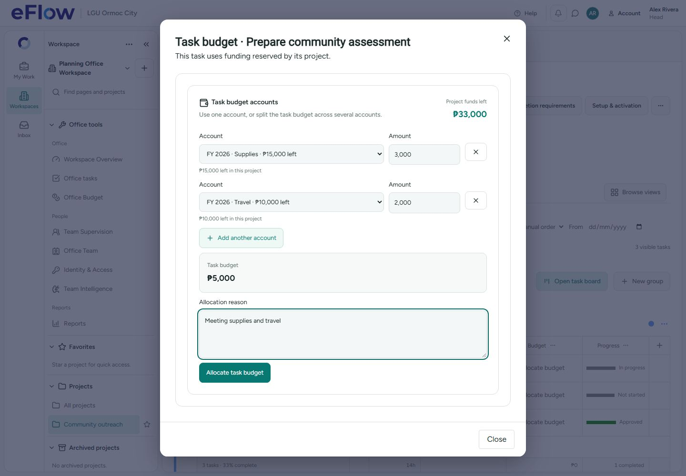
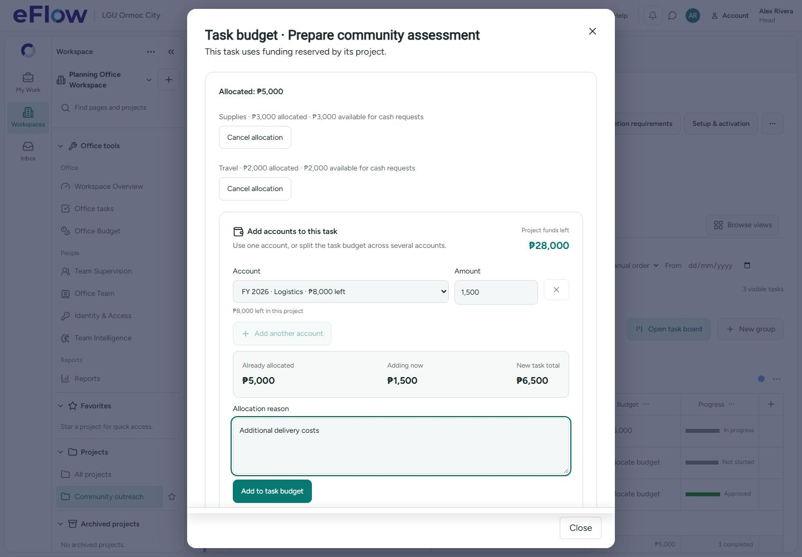

# One or multiple budget accounts per task — 3 November 2026

Status: deployed to `ixnfphgjyelhckjwjkdv` after explicit user sign-off on 3 November 2026 (Asia/Manila). All 21 installed database checks passed and rolled back their QA records.

A task may use one project-funded account or split its budget across several. The account picker shows the amount remaining in the project. Zero balances are hidden and the same account cannot be selected twice. The form shows the combined task budget; when adding another account later, it shows the existing budget, the amount being added and the new total.

The former restriction hid the picker after the first allocation and rejected any further allocation on that task. The new path appends new account lines to its existing approved allocation without cancelling it, replacing existing line IDs, or clearing spending, advances or subtask protection. Existing fiscal-year compatibility and project lead/Head authorization rules remain in place. Account additions are audited and idempotent; the Office Budget is not charged a second time.

## Checks

- 17 focused UI/interaction/error tests passed across task funding, project setup and funding messages.
- 21 native PostgreSQL checks passed in a rollback-only transaction. These cover multiple accounts initially, a newly authorized project account added to an already funded task, original line IDs and protected subtask funding, retry identity, duplicate account rejection, other tasks consuming the same account, exact remaining-balance allocation and failed writes leaving both balances unchanged.
- Chromium desktop walkthrough passed: allocate Supplies + Travel, add Logistics, check the total, close and reload. Desktop overflow and footer visibility were also checked at 1280×800. It uses intercepted synthetic records, not hosted financial transactions.
- TypeScript and production build passed; existing build chunk warnings remain. Architecture graph refreshed with its known four partial-parser warnings.
- No permanent QA projects, task allocations, cash transactions or account changes were created.

## Migration package

`20261102182541_task_multiple_budget_accounts.sql` updates only the existing private allocation and project snapshot functions. The public allocation API and its payload remain unchanged; the snapshot adds account IDs, fiscal years and an extension-capability flag. The UI keeps the old funded-task behavior until that flag is available.

A verified database/role backup exists outside Git. An isolated workspace was populated from all 71 current hosted migration versions. Dry run selected only the reviewed delta, with no seeds, roles or history repair. All 117 checked application/financial table fingerprints remained unchanged. See `CANDIDATE_CHECKS.json` and `DEPLOYMENT_PREFLIGHT.json`.

The user approved the exact migration. Backup and function-drift checks passed again; the isolated deployment applied only this migration, preserving the preceding 71 migration versions. All 117 checked application/financial table contents remained unchanged. See `DEPLOYMENT_RECEIPT.json` and `INSTALLED_CHECKS.json`. The installed checks verify account limits, duplicate rejection, retry safety and preserved allocation IDs and subtask funding. The security advisor has no findings for the changed private functions or public allocation wrapper; existing project-wide advisories remain recorded in `SECURITY_ADVISORS.json`.

