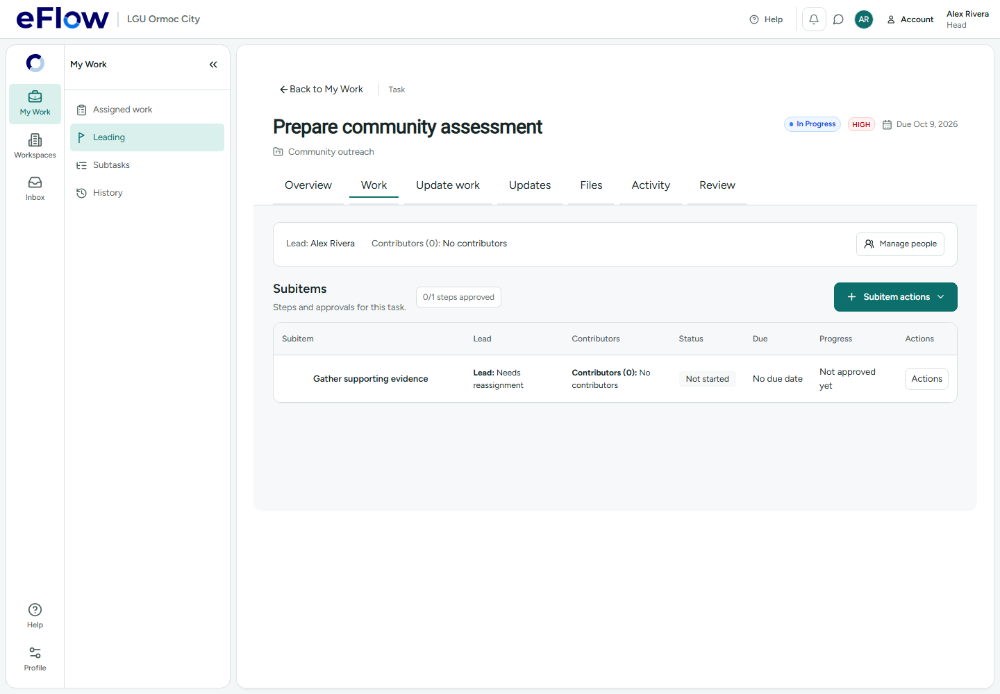
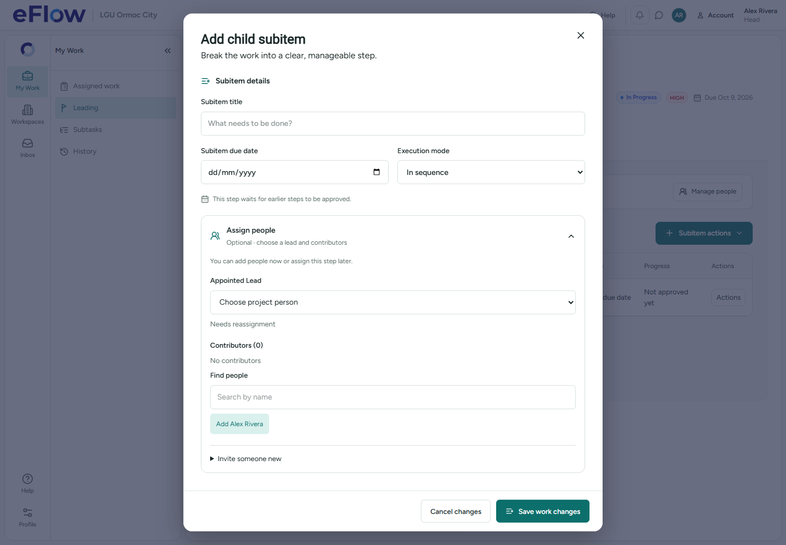
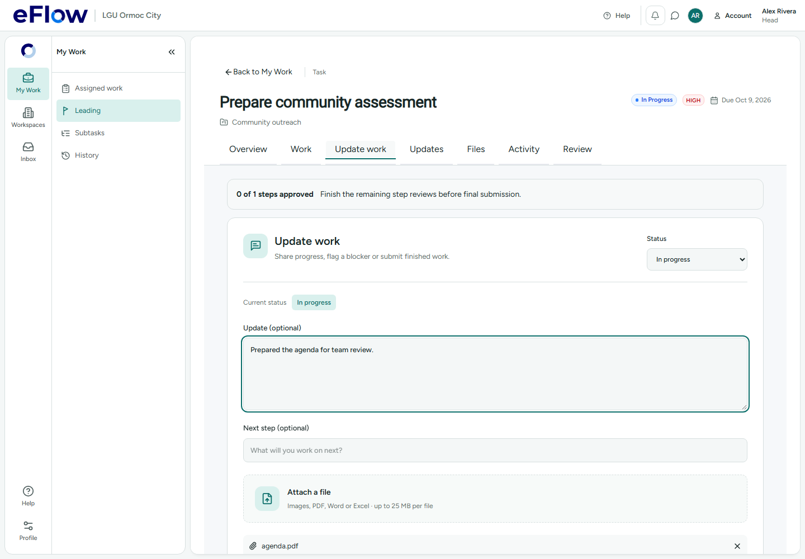

# Task work and subitem design — 30 October 2026

## Changes

- **Child-subitem modal:** grouped details, side-by-side date/execution controls, concise sequence guidance, a separate optional people section, larger inputs and a persistent action footer with a teal primary save button. Existing fields, invitations, capability checks, validation, draft recovery and request identity are preserved.
- **Update work:** a dedicated task tab owns status changes, blocker reporting, notes, next steps, attachments and submission. Historical report-blocker and submit-work entrances open that tab. The existing Work tab retains subitems and staffing. Updates remains the discussion/history destination.
- **Attachments:** replaced the browser's exposed file-input chrome with an accessible styled file picker. File types, size/count limits, selection/removal and actual save callbacks are unchanged.
- **People:** replaced the large page-level Task team card with a compact lead/contributor bar and Manage people action. Authorization and the shared tree controller remain unchanged.
- **Subitem actions:** a green Subitem actions dropdown appears next to the section heading, above the list surface. Its existing commands and capability restrictions remain intact.
- **Quiet updates:** the existing 15-second/focus background refresh retains loaded subitems without repeatedly announcing Loading subitems. Initial loading and genuine errors remain visible. No recurring manual refresh is required. The heading now says Steps and approvals for this task, with a compact approval count when steps exist.

## Validation

- TypeScript and production build passed.
- 149 affected unit tests checked across six files: 146 passed on the first run; three recovery interactions exceeded the default 5-second limit under concurrent build/browser load. All three passed unchanged in an isolated run with a 20-second ceiling (actual durations 2.1–4.3 seconds). No assertions were removed.
- Two desktop Chromium scenarios passed, covering the My Work page at 1440 × 1000 and 1100 × 850, update attachments, guarded tab changes, the centered subitem dialog and idempotent retry after a lost receipt. Backend records in these scenarios are synthetic fixtures; no hosted data or emails were changed.
- The quiet-refresh regression holds a refresh response open, proves the existing hierarchy stays visible without loading text, then verifies the new server snapshot appears without a write.

## Screenshots

Smaller desktop: [Work](screenshots/work-1100.png), [Update work](screenshots/update-work-1100.png).
