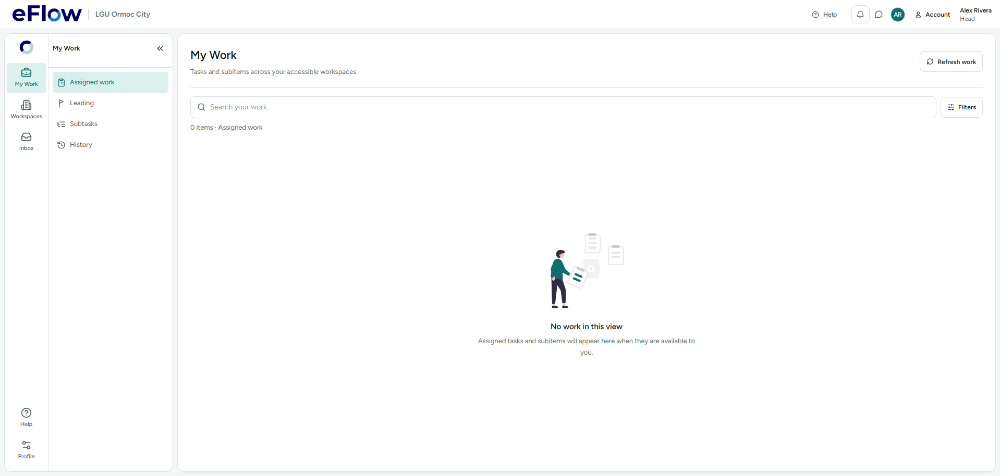
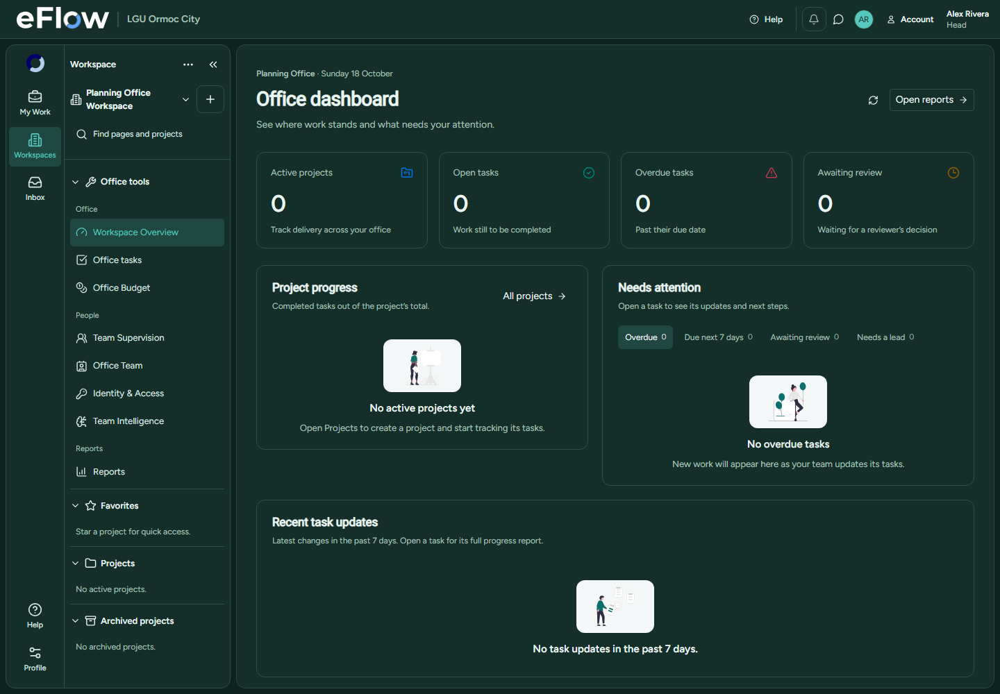

# unDraw empty-state rollout

Historical report: the artwork in this rollout was subsequently replaced by [animated Storyset illustrations](storyset-empty-states-2026-10-18.md). The unDraw asset files are no longer shipped.

18 October 2026. Implements the illustrated states discussed after the [message inventory](EMPTY_STATE_MESSAGE_MAP_2026-10-18.md), including the requested vertical centering correction.

Ten selected unDraw SVGs are bundled in `public/illustrations/undraw/`, with eFlow's `#0c6f6b` accent. The site color picker was exercised directly. The displayed vectors were saved locally after the browser download event did not complete. Source paths and proportions were preserved, and all SVGs passed XML parsing and checks for scripts, event handlers, foreign objects and external resources. Asset names and license provenance are in that folder's README. There are no runtime unDraw requests or new dependencies.

## Presentation

- My Work's Assigned work, Leading, Subtasks and History states center in the space remaining below their header, filters and result count, adapting to a resized scrollport. The same opt-in layout is used for main empty collections in Inbox, Office Team, task board tools, templates and applicable review queues.
- Cards and secondary sections use bounded, centered layouts. Tables center their illustration in the empty table body. Small dropdown options, field placeholders, sidebar hints and validation messages retain compact text or their existing icons.
- Mailbox: notifications, updates and invitations. Search: filtered results. Blank canvas: projects and work plans. Add notes: work and task history. Well done: clear review/settlement queues. Documents: files and evidence. Friends: teams. Empty wallet: budget setup and registers. Chat: conversations. No data: general record collections.
- Explicit illustration choices are passed by the owning screen. FeedbackState errors, warnings, loading and save receipts do not acquire illustrations automatically. Existing text and action controls are retained. Account Audit read failures now use the DataTable error branch rather than a decorated empty result.
- Decorative images have empty alt text, reserved dimensions, `object-fit: contain`, no animation, and a light backing in dark mode so their original neutral strokes remain readable.

## Boundaries

Presentation changes only: no database migration, RLS, backend, payload, role visibility or navigation changes. Historical/source-only pages were not revived. The earlier message inventory is a point-in-time source map; its file line references predate this rollout.

Personal workspace follow-up: both the no-project and unselected-project overview states now use the remaining-height page layout. The workspace header no longer displays its timezone. Typecheck, build, 8 focused unit tests and 2 Chromium cases passed; browser coverage checks both states at 375 and 1918 pixels. See [the personal workspace preview](ui-empty-states/2026-10-18/personal-workspace-centered.png).

## Evidence

- Typecheck and production build passed. Existing large-chunk warning remains.
- Three new focused interaction tests passed: loading/error/data boundaries, recovering from table search, and preserved action/custom visual behavior. Existing Account Audit and BudgetSectionEditor tests also passed in the focused run (8 tests).
- All 9 Chromium tests passed: all four roles, centering across all four My Work tabs plus mobile resize, search recovery, and Head dashboard at 375/768/1440 pixels with dark mode and reduced motion. The first search-recovery run stopped on an ambiguous test locator before searching; the scoped button locator passed on rerun.
- Browser tests use synthetic intercepted records; no live accounts or work data were modified.
- Graphify was refreshed; the four existing partial-extraction warnings remain.
- The full three-worker run finished after delivery: **1,916 passed, 25 failed, 1,941 total**. Three failures were from the new test file loaded before its jsdom setup was corrected; all three passed on the corrected focused rerun. The remaining failures cover existing navigation/nested-work/staffing tests, including timeout failures; the full suite is not green. Raw results are in `.codex-tmp/empty-states/unit-results.json`, with a compact failure list in `full-suite-summary.json`. No unrelated failing workflows were changed as part of the illustration rollout.

