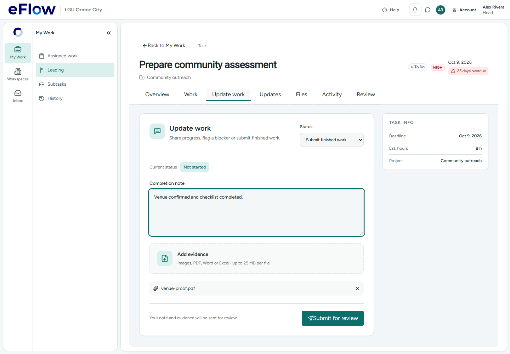

# Lead completion and work-update notifications — 3 November 2026

Status: deployed to `ixnfphgjyelhckjwjkdv`. Only migration `20261102190846_work_completion_and_update_notifications` was applied, from an isolated workspace populated with the preceding 72 live migration versions. Backup/function drift checks passed; all 117 checked application/financial tables retained their existing contents.

## Failures found and fixes

1. **A Task Lead could finish a delegated subtask but could not upload its evidence.** The execution capability allowed the current Task Lead, while Storage's upload helper checked only the people directly assigned to the subtask. An authenticated rollback-only insert reproduced the RLS rejection. The helper now uses the same checked execution capability. Actor eligibility, project membership, open-work checks, ownership and evidence immutability remain enforced.
2. **Completion evidence was checked against the wrong folder.** Completion uploads use the completion request UUID; the evidence trigger always expected `/progress/`. Completing with a file reproduced “Evidence path does not belong to this task and attempt.” Direct completion now seals the validated completion request's files; ordinary updates still require `/progress/`. All files are preserved, and multiple files or a retry produce one completion notification.
3. **Starting and submitting were separate requests.** A delayed render or another participant starting the task could make the first request fail with “Task is already in progress.” The lead's final submission now starts open/not-started or returned work and submits it in the same locked transaction. Evidence can be uploaded by that lead before this transaction. Completed, archived or review-pending tasks stay protected. Subtask, dependency and financial guards remain in force.
4. **Inconsistent lead checks and an obsolete preflight.** The parent RPC's nullable `assigned_to OR recommendation_lead_id` check was inconsistent with the canonical current lead. The downstream guard already rejected the contributor in reproduction; this was not a proven successful contributor bypass. The earlier check now also uses the current assigned lead, with the recommendation only as fallback. The client no longer applies an organization-only Head check to project work; the server resolves the current Project Lead/independent Head review route.
5. **Text updates still generated `0%` notifications.** The old trigger interpolated the stored legacy percentage, even when the update was a note, blocker or next step. New notifications describe work updates, blockers or completion and include the exact subtask ID. Existing notifications lose only the generated percentage phrase when displayed; authored notes and historical rows are preserved. Task/subtask update history no longer displays legacy percentages.

## Verification

- 16 checks passed against the installed database functions, using authenticated roles inside a rolled-back transaction. They cover current lead submission, contributor/stale-recommendation rejection, not-started parent submission with evidence, delegated subtask evidence, multiple sealed files, replay without duplicate notifications, plain-language update/blocker messages, exact subtask links, unfinished-step protection and deferred workflow/financial guards.
- 30 focused web tests passed for atomic submission, project review preflight, notification copy/navigation, update history and submission readiness.
- A Chromium desktop check passed at 1440×1000: the lead uploads evidence and submits through one command, without a second start request. Its API responses are intercepted synthetic fixtures; the database checks above are separate installed-backend evidence.
- TypeScript and production build passed. Existing build chunk warnings remain. The architecture map was refreshed with its four known partial-parser warnings.
- Security advisory counts remain unchanged; no grants or RLS policies were changed. See `SECURITY_ADVISORS.json`.

No live task was completed, cash released, invitation sent or account changed by these checks. QA records and synthetic Storage metadata were rolled back; no real file was uploaded to hosted Storage.

